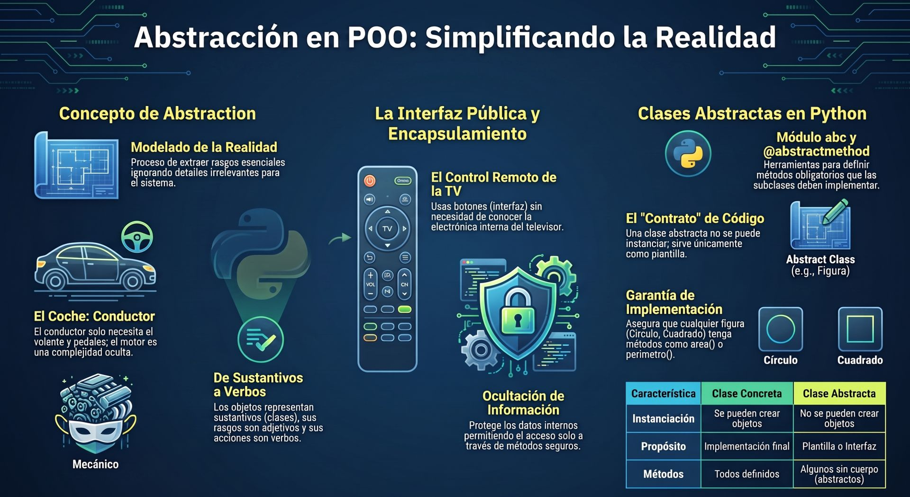
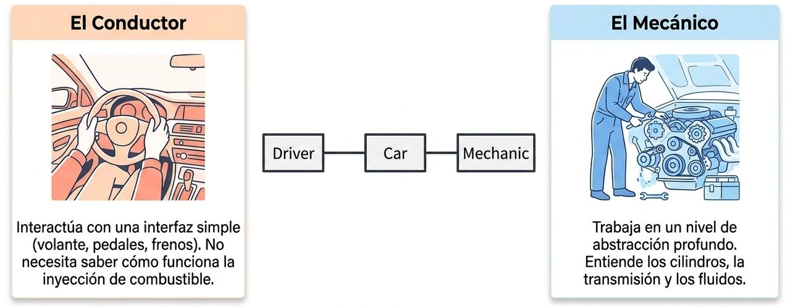
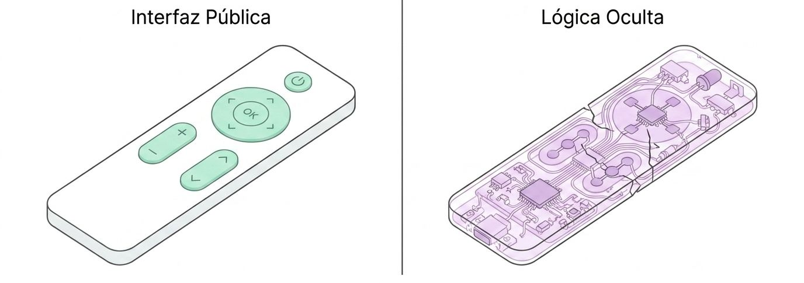
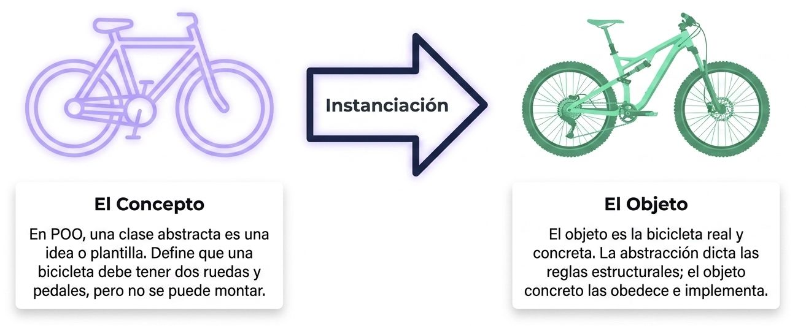
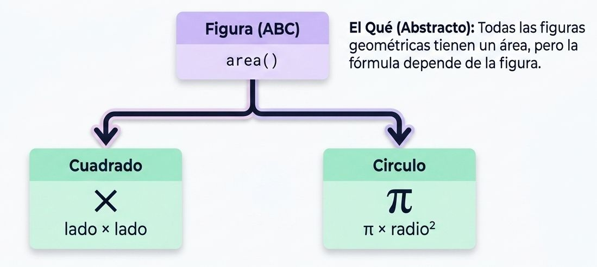

:::info[Código]
[](https://colab.research.google.com/drive/18yhVWLuLkS949y8DkSVWYUViS4Erg8mj?usp=sharing)
:::

La **abstracción** es uno de los pilares fundamentales de la Programación Orientada a Objetos (POO). Consiste en el proceso de **separar una interfaz pública limpia de los detalles internos de implementación** de un objeto, permitiendo interactuar con el código al nivel de detalle más adecuado para cada tarea y omitiendo las complejidades que no son relevantes.




En términos de diseño, la abstracción nos ayuda a "ignorar los detalles irrelevantes" para enfocarnos exclusivamente en el modelo que realmente necesitamos reproducir en el software.

### Analogías del mundo real
Ejemplos cotidianos:
*   **El coche:** Un conductor interactúa con el vehículo a través de un nivel de abstracción muy simple: el volante, el acelerador y el freno. No necesita saber cómo funciona internamente la transmisión, el motor o el sistema hidráulico de frenado para poder conducir. Sin embargo, un mecánico trabaja en un nivel de abstracción diferente, lidiando de forma directa con la afinación del motor y el mantenimiento de las piezas.

<center>
<figure>

<figcaption>**Abstracción**. Usamos objetos complejos sin necesidad de entender su mecánica interna.</figcaption>
</figure>
</center>

*   **La televisión:** La interfaz pública que utilizamos para interactuar con ella es el control remoto. Cada botón representa un método. Al pulsarlo, no nos importa si la televisión procesa señales por cable o satélite, ni los flujos de corriente eléctrica necesarios para ajustar el volumen.

<center>
<figure>

<figcaption>**Abstracción**. Usas los botones (métodos) para cambiar de canal. No necesitas entender los Círculos internos (atributos y lógica) para que el televisor funcione. El fabrivante oculta la complejidad para tu comodidad.</figcaption>
</figure>
</center>

En la abstracción la clase se trata como una plantilla a partir de la cual se crean y funcionan otras plantillas. Una clase de tipo abstracta es una "idea" que se define en forma general.

<center>
<figure>

<figcaption>La clase como concepto.</figcaption>
</figure>
</center>

En Python, existen principalmente dos formas de abordar la abstracción: mediante **Clases Base Abstractas** o mediante el enfoque dinámico de **Duck Typing**.

## **Clases Base Abstractas (módulo `abc`)**

Las clases base abstractas (ABCs) en Python funcionan como plantillas o contratos formales para estructurar la arquitectura del código. Su propósito principal es definir una interfaz compartida que obliga a las subclases a implementar determinados métodos, evitando que la clase base sea instanciada directamente.

Cuando se requiere una estructura formal —por ejemplo, al diseñar complementos (plugins) de terceros donde se quiere documentar el comportamiento esperado—, Python ofrece el módulo **`abc`** (Abstract Base Classes).
*   **Clases abstractas:** Actúan como una plantilla genérica que no se puede instanciar (crear un objeto de ella) de forma directa.

*   **Métodos abstractos:** Utilizan el decorador **`@abstractmethod`** para actuar como marcadores de posición (*placeholders*). Estos métodos declaran una obligación: *"exigimos que este método exista en cualquier subclase no abstracta, pero nos negamos a definir una implementación concreta en esta clase"*.

### Funcionamiento

1. **Definición formal:** Se crean heredando de la clase ABC del módulo integrado abc

2. **Métodos abstractos:** Se decoran con @abstractmethod para actuar como marcadores de posición (placeholders) sin implementación concreta en la clase base

3. **Validación en la instanciación:** Si se intenta instanciar la clase abstracta directamente, o si una subclase olvida implementar alguno de los métodos abstractos declarados, Python bloquea la creación del objeto lanzando una excepción TypeError

4. **Estado compartido:** Una clase abstracta puede incluir un constructor __init__ tradicional con atributos compartidos para todas sus subclases


<center>
<figure>

<figcaption>**El Cómo**. Las clases hijas hijas implementan la matemática real. El programa principal solo necesita llamar a .area() sin preocuparse de la fórmula exacta.</figcaption>
</figure>
</center>

Las clases base abstractas (ABCs) se definen heredando de la clase ABC del módulo abc y utilizando el decorador @abstractmethod. Actúan como una plantilla u obligación contractual: no se pueden instanciar directamente y exigen que sus subclases concretas implementen todos los métodos marcados como abstractos.


### Ejemplos prácticos

<details>
<summary>🖥️ **Figuras**</summary>

Creamos una clase maestra **Figura** con un método `calcular_area` y `perimetro`, sin embargo, solo **area** definimos con `abstractmethod`, por lo que solo este es obligatorio.
```python showLineNumbers
from abc import ABC, abstractmethod
import math

class Figura(ABC):
    """Clase abstracta que actúa como molde para cualquier figura geométrica."""

    @abstractmethod
    def calcular_area(self) -> float:
        """Método abstracto. Las subclases deben definir cómo calcular su área."""
        pass

    def perimetro(self) -> float:
        """Método que calcula el perímetro de la figura."""
        pass

class Circulo(Figura):
    def __init__(self, radio: float):
        self.radio = radio

    def calcular_area(self) -> float:
        # Implementación de la fórmula específica para el círculo
        return math.pi * (self.radio ** 2)

    def perimetro(self) -> float:
        # Implementación de la fórmula específica para el círculo
        return 2 * math.pi * self.radio

class Rectangulo(Figura):
    def __init__(self, base: float, altura: float):
        self.base = base
        self.altura = altura

    def calcular_area(self) -> float:
        # Implementación de la fórmula específica para el rectángulo
        return self.base * self.altura

    def perimetro(self) -> float:
        # Implementación de la fórmula específica para el rectángulo
        return 2 * (self.base + self.altura)

# triangulo ??

# Uso del código:
# figura = Figura()  # Esto lanzará un TypeError automáticamente en Python.
circulo = Circulo(5.0)
print(f"Área del círculo: {circulo.calcular_area():.2f}")
print(f"Perimetro es {circulo.perimetro}")

rectangulo = Rectangulo(4.0, 6.0)
print(f"Área del rectángulo: {rectangulo.calcular_area():.2f}")
print(f"Perimetro es {rectangulo.perimetro}")

```
Si se define una clase Rectangulo sin el método calcular_area generará un error.

Si intentamos crear una instancia de una clase derivada que no implementa todos los métodos abstractos (por ejemplo, definir un objeto `Wav` que herede de la clase de carga `MediaLoader` pero que omita la definición del método `play`), Python lanzará una excepción `TypeError` en tiempo de ejecución.
</details>

<details>
<summary>🖥️ **Gestión de Nómina y Contratos (`Empleado`)**</summary>

En este modelo, la clase abstracta centraliza los datos comunes (`nombre` y `salario_base`), pero delega la fórmula final de pago a la lógica concreta de cada subclase:

```python
from abc import ABC, abstractmethod

class Empleado(ABC):
    def __init__(self, nombre: str, salario_base: float):
        self.nombre = nombre
        self.salario_base = salario_base

    @abstractmethod
    def calcular_pago_neto(self) -> float:
        """Contrato obligatorio para calcular el sueldo neto."""
        pass

class EmpleadoPlanta(Empleado):
    def __init__(self, nombre: str, salario_base: float, bono: float):
        super().__init__(nombre, salario_base)
        self.bono = bono

    def calcular_pago_neto(self) -> float:
        return self.salario_base + self.bono

class EmpleadoFreelance(Empleado):
    def __init__(self, nombre: str, salario_base: float, retencion: float):
        super().__init__(nombre, salario_base)
        self.retencion = retencion

    def calcular_pago_neto(self) -> float:
        return self.salario_base * (1 - self.retencion)

# Uso del código:
nomina = [
    EmpleadoPlanta("Carlos", 2500.0, 300.0),
    EmpleadoFreelance("Sofía", 1800.0, 0.10)
]

for emp in nomina:
    print(f"Empleado: {emp.nombre} | Pago Neto: ${emp.calcular_pago_neto():.2f}")
```
</details>


<details>
<summary>🖥️ **Generación Aleatoria de Dados (`Die`)**</summary>

En este diseño, el constructor de la clase abstracta invoca al método abstracto `roll()` durante la instanciación. Esto garantiza que cualquier variante de dado (`D4`, `D6`) genere su valor inicial de inmediato según sus propias reglas:

```python
import abc
import random

class Die(abc.ABC):
    def __init__(self) -> None:
        self.face: int
        self.roll()  # Invoca la lógica de la subclase durante __init__

    @abc.abstractmethod
    def roll(self) -> None:
        """Determina cómo el dado genera su valor aleatorio."""
        pass

    def __repr__(self) -> str:
        return f"Cara: {self.face}"

class D4(Die):
    def roll(self) -> None:
        self.face = random.choice((1, 2, 3, 4))

class D6(Die):
    def roll(self) -> None:
        self.face = random.randint(1, 6)

# Uso del código:
dado_seis = D6()
print("Resultado inicial:", dado_seis)
dado_seis.roll()
print("Nuevo lanzamiento:", dado_seis)
```
</details>


### La alternativa dinámica: Duck Typing y Protocolos

A diferencia de otros lenguajes más rígidos y de tipado estático, en Python la herencia formal para hacer abstracción es opcional gracias al **Duck Typing** ("tipado de pato"). Este principio sostiene que: *"Si camina como un pato y grazna como un pato, entonces es un pato"*.
*   En la práctica, esto significa que el programa no necesita comprobar si un objeto pertenece a una clase o jerarquía estricta; **lo único que importa es qué métodos y atributos tiene disponibles**. Por ejemplo, cualquier objeto que tenga un método `.play()` puede ser consumido por un reproductor, sin importar si hereda de una clase base común o no.

*   Para formalizar estas interfaces sin forzar la herencia en tiempo de ejecución, Python permite el uso de **`typing.Protocol`**, que define contratos conceptuales que pueden ser validados de manera estática por herramientas de análisis como `mypy` antes de ejecutar el código.

---

### Diferencia entre Duck Typing y ABCs

Aunque tanto el **Duck Typing** como las **ABCs (Abstract Base Classes)** sirven para implementar polimorfismo y definir contratos o interfaces en Python, abordan este problema desde filosofías completamente opuestas. 

La diferencia principal radica en **cómo y cuándo** se valida que un objeto cumple con una interfaz, y el **nivel de acoplamiento** que exigen en el código.


### Filosofía y Enfoque

*   **Duck Typing (Tipado de Pato):** Se basa en el principio pragmático e implícito de: *"si camina como un pato y grazna como un pato, entonces es un pato"*. Bajo esta filosofía, **lo que importa es lo que un objeto puede hacer (sus métodos y atributos), no lo que realmente es (su clase o su herencia)**. Es dinámico por naturaleza y asume que el objeto funcionará en el contexto dado hasta que se demuestre lo contrario en tiempo de ejecución (estilo EAFP: *es más fácil pedir perdón que permiso*).

*   **ABCs (Clases Base Abstractas):** Es un enfoque mucho más formal, heredado de la POO clásica. Un ABC define un plano o plantilla (*blueprint*) con métodos marcados explícitamente mediante el decorador `@abstractmethod`. Estos métodos actúan como marcadores de posición vacíos (`...`) que **obligan** a cualquier subclase no abstracta a proporcionar una implementación concreta.


### Tabla Comparativa

| Característica | Duck Typing | ABCs (Abstract Base Classes) |
| :--- | :--- | :--- |
| **Declaración** | **Implícita.** No requiere herencia formal ni importar módulos especiales. | **Explícita.** La clase abstracta debe heredar de `abc.ABC` (o usar la metaclase `ABCMeta`). |
| **Momento de Validación** | **En ejecución (u opcionalmente en estático).** Falla en el momento exacto en el que intentas invocar un método inexistente. | **En la instanciación.** Python impide crear un objeto de la subclase si esta no ha implementado todos los métodos abstractos, lanzando un `TypeError`. |
| **Acoplamiento** | **Extremadamente débil.** Facilita que componentes desarrollados de manera independiente encajen de inmediato. | **Más fuerte.** Tradicionalmente obliga a heredar de la clase base para ser reconocido como tipo válido. |
| **Uso de Herramientas** | Se beneficia de **`typing.Protocol`** para análisis estáticos. | Se apoya en el módulo **`abc`** de la biblioteca estándar y validaciones en ejecución de Python. |


### El punto de encuentro
**`__subclasshook__` e Interfaces Implícitas**

A pesar de ser conceptos opuestos, Python permite fusionar la formalidad de las ABCs con el dinamismo del Duck Typing mediante el método especial **`__subclasshook__`**.

Si defines este método de clase dentro de un ABC, puedes programar lógica personalizada para que funciones como `isinstance()` o `issubclass()` reconozcan a un objeto como miembro de esa clase abstracta **sin necesidad de que herede formalmente de ella**. Esto evalúa la estructura interna del objeto en tiempo de ejecución:

```python showLineNumbers
# Ejemplo conceptual de cómo las ABCs de Python usan subclass hooks
# (Así es como collections.abc valida si eres un 'Container')
class Container(ABC):
    @abstractmethod
    def __contains__(self, x):
        return False

    @classmethod
    def __subclasshook__(cls, C):
        if cls is Container:
            if any("__contains__" in B.__dict__ for B in C.__mro__):
                return True
        return NotImplemented
```


Gracias a esto, cualquier clase que defina un método `__contains__` se considerará automáticamente una subclase de `Container` ante `isinstance()` o `issubclass()`, beneficiándose del Duck Typing pero con una verificación formal.


### Cuándo usar cada enfoque

*   **Usa Duck Typing cuando:**
    *   Diseñes sistemas flexibles donde las jerarquías de herencia resulten molestas o artificiales (por ejemplo, querer que un `Archivo`, una `ConexiónDeRed` o un `StringIo` se comporten de manera intercambiable porque todos soportan el método `read()`).
    *   Quieras facilitar la extensión de tu biblioteca por parte de terceros sin forzarlos a importar tus clases base.
    *   *Nota:* Si quieres añadirle seguridad a este enfoque, puedes documentar tus interfaces usando **`typing.Protocol`**.

*   **Usa ABCs cuando:**
    *   Estés construyendo frameworks grandes y quieras **garantizar que los plugins o extensiones implementen la interfaz completa** desde el momento en que se crean sus objetos, evitando fallos tardíos a mitad de la ejecución.
    *   Diseñes colecciones personalizadas que deban integrarse de manera limpia y estricta con los tipos integrados de Python (heredando, por ejemplo, de `collections.abc.MutableMapping` para crear un diccionario especializado).
    *   Quieras estructurar plantillas de comportamiento donde la clase base defina el flujo general (patrón de diseño *Template Method*) y deje solo ciertos pasos específicos a las subclases.


---
## 📝 **Test:** Abstracción

Antes de continuar, comprueba tus conocimientos.


import QuizComponent from '@site/src/components/Quiz';
import quiz from '@site/src/components/Quiz/data/poo-abstraccion.json';


<QuizComponent quiz={quiz} showInstantFeedback />