## **Tkinter UI**

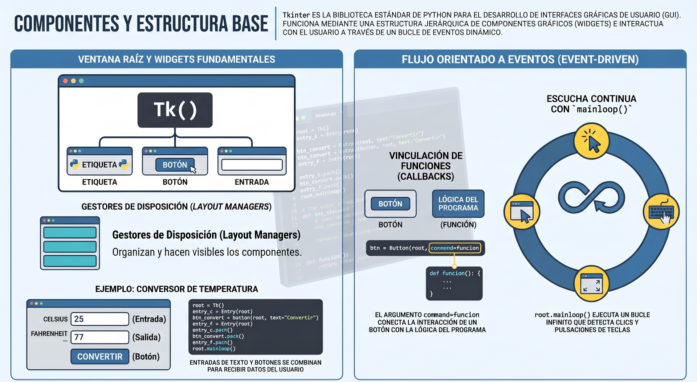

**Tkinter** es la biblioteca e interfaz estándar de Python para la creación de **Interfaces Gráficas de Usuario (GUI)**. Es una capa orientada a objetos construida sobre el conjunto de herramientas gráficas **Tk** (proveniente del lenguaje Tcl).

Su principal característica es que viene **incluida por defecto en la instalación estándar de Python** en la mayoría de los sistemas operativos (Windows, macOS y muchas distribuciones de Linux). Esto permite desarrollar aplicaciones de escritorio portátiles con un aspecto gráfico nativo sin necesidad de instalar dependencias externas complejas.


### Conceptos clave

1. **Programación orientada a eventos (Event-Driven Programming):**
   A diferencia de los scripts secuenciales que se ejecutan de principio a fin y finalizan, una aplicación GUI en Tkinter construye los elementos de la interfaz y entra en un **bucle principal de eventos** (`root.mainloop()`). Este bucle escucha de forma continua las acciones del usuario (clics del ratón, pulsaciones de teclas o movimientos) para reaccionar ejecutando funciones asociadas.

2. **Jerarquía de Widgets:**
   Los **widgets** son los componentes gráficos interactivos. Toda interfaz en Tkinter requiere:
   * **Ventana principal (*root*):** La ventana base creada con `root = tk.Tk()`.
   * **Widgets individuales:** Como `Label` (etiquetas de texto), `Button` (botones), `Entry` (campos de texto de una línea) o `Canvas` (áreas de dibujo).
   * **Widgets contenedores (`Frame`):** Paneles para agrupar y organizar visualmente otros widgets dentro de la ventana.

3. **Gestores de diseño (*Layout Managers*):**
   Para que un widget aparezca en la pantalla, debe ser posicionado mediante un gestor de diseño:
   * **`pack()`:** Apila los widgets secuencialmente de arriba abajo o de izquierda a derecha.
   * **`grid()`:** Organiza los elementos en una cuadrícula bidimensional de filas y columnas.
   * **`place()`:** Permite posicionar widgets mediante coordenadas absolutas o relativas.

4. **Vinculación de acciones (*Callbacks* y *Event Binding*):**
   * **Parámetro `command`:** Permite enlazar directamente la acción de un botón con una función en Python.
   * **Método `.bind()`:** Asocia eventos específicos del sistema (como clics del ratón o atajos de teclado) a funciones manejadoras.
   * **Variables de control (`StringVar`, `IntVar`):** Objeto conectado a widgets como `Entry` que permite leer y modificar su contenido de forma dinámica con `.get()` y `.set()`.


### Ejemplo de uso

El siguiente script muestra cómo crear una ventana interactiva sencilla con Tkinter:

```python showLineNumbers
import tkinter as tk
from tkinter import messagebox

# Función callback asociada al botón
def saludar():
    nombre = entrada_nombre.get()
    if nombre.strip():
        messagebox.showinfo("Bienvenido", f"¡Hola, {nombre}!")
    else:
        messagebox.showwarning("Atención", "Por favor ingresa tu nombre.")

# 1. Crear la ventana principal
root = tk.Tk()
root.title("Mi Aplicación")
root.geometry("300x150")

# 2. Crear y organizar los widgets
etiqueta = tk.Label(root, text="Ingresa tu nombre:")
etiqueta.pack(pady=5)

entrada_nombre = tk.Entry(root)
entrada_nombre.pack(pady=5)

boton = tk.Button(root, text="Saludar", command=saludar)
boton.pack(pady=10)

# 3. Iniciar el bucle de eventos
root.mainloop()
```
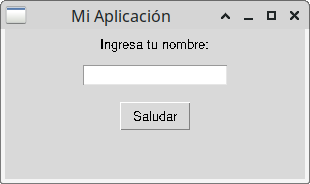

***
## **Tkinter bajo POO**

Para escalar y mantener aplicaciones gráficas en **Tkinter**, la mejor práctica de la industria es combinar la **Programación Orientada a Objetos (POO)** con el gestor de diseño **`grid()`**.

A diferencia del estilo imperativo tradicional (donde las variables globales quedan dispersas), estructurar Tkinter mediante clases permite encapsular el estado de la ventana, aislar la lógica de cada componente y diseñar formularios precisos organizados en filas y columnas.

### Ejemplo

<br/>
<Tabs>
<TabItem value="ej1" label="Ejemplo" default>
<div class="alert alert--primary">

**Formulario de Registro Modular**

El siguiente script implementa una aplicación completa heredando de `tk.Tk` y organizando todos sus elementos mediante `grid()`:
<center>
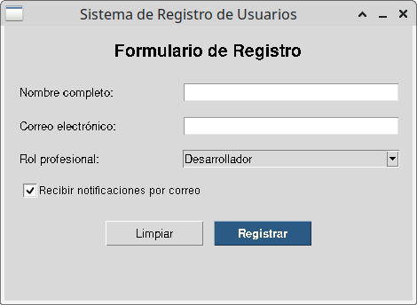
</center>
</div>
</TabItem>
<TabItem value="ej1-python" label="🖥️ Código" >

```python showLineNumbers
import tkinter as tk
from tkinter import messagebox, ttk

class FormularioRegistroApp(tk.Tk):
    """
    Aplicación de escritorio para el registro de usuarios.
    Estructurada con POO (hereda de tk.Tk) y organizada con el gestor 'grid'.
    """
    def __init__(self):
        super().__init__()
        
        # 1. Configuración de la ventana principal
        self.title("Sistema de Registro de Usuarios")
        self.geometry("460x310")
        self.resizable(False, False)
        
        # 2. Variables de control encapsuladas en la instancia
        self.var_nombre = tk.StringVar()
        self.var_email = tk.StringVar()
        self.var_rol = tk.StringVar(value="Desarrollador")
        self.var_notificaciones = tk.BooleanVar(value=True)
        
        # 3. Inicialización de los componentes gráficos
        self._crear_widgets()
        
    def _crear_widgets(self):
        # Configurar la distribución de peso entre columnas
        self.grid_columnconfigure(0, weight=1)
        self.grid_columnconfigure(1, weight=2)
        
        # --- Título Principal ---
        lbl_titulo = tk.Label(
            self, 
            text="Formulario de Registro", 
            font=("Helvetica", 14, "bold")
        )
        # Ocupa 2 columnas con columnspan=2
        lbl_titulo.grid(row=0, column=0, columnspan=2, pady=(15, 15), sticky="n")
        
        # --- Campo 1: Nombre ---
        lbl_nombre = tk.Label(self, text="Nombre completo:", font=("Helvetica", 10))
        lbl_nombre.grid(row=1, column=0, padx=15, pady=8, sticky="w")
        
        ent_nombre = tk.Entry(self, textvariable=self.var_nombre, font=("Helvetica", 10))
        ent_nombre.grid(row=1, column=1, padx=15, pady=8, sticky="ew")
        
        # --- Campo 2: Correo Electrónico ---
        lbl_email = tk.Label(self, text="Correo electrónico:", font=("Helvetica", 10))
        lbl_email.grid(row=2, column=0, padx=15, pady=8, sticky="w")
        
        ent_email = tk.Entry(self, textvariable=self.var_email, font=("Helvetica", 10))
        ent_email.grid(row=2, column=1, padx=15, pady=8, sticky="ew")
        
        # --- Campo 3: Rol Profesional (Combobox) ---
        lbl_rol = tk.Label(self, text="Rol profesional:", font=("Helvetica", 10))
        lbl_rol.grid(row=3, column=0, padx=15, pady=8, sticky="w")
        
        cmb_rol = ttk.Combobox(
            self, 
            textvariable=self.var_rol, 
            values=["Desarrollador", "Diseñador", "Analista de Datos", "Administrador"],
            state="readonly",
            font=("Helvetica", 10)
        )
        cmb_rol.grid(row=3, column=1, padx=15, pady=8, sticky="ew")
        
        # --- Campo 4: Casilla de Verificación (Checkbutton) ---
        chk_notif = tk.Checkbutton(
            self, 
            text="Recibir notificaciones por correo", 
            variable=self.var_notificaciones,
            font=("Helvetica", 9)
        )
        chk_notif.grid(row=4, column=0, columnspan=2, padx=15, pady=8, sticky="w")
        
        # --- Botones de Acción (Anidados en un Panel) ---
        frame_botones = tk.Frame(self)
        frame_botones.grid(row=5, column=0, columnspan=2, pady=(15, 10))
        
        btn_limpiar = tk.Button(
            frame_botones, 
            text="Limpiar", 
            command=self._limpiar_formulario, 
            width=12
        )
        btn_limpiar.grid(row=0, column=0, padx=5)
        
        btn_guardar = tk.Button(
            frame_botones, 
            text="Registrar", 
            command=self._guardar_registro, 
            bg="#2b5b84", 
            fg="white", 
            width=12,
            font=("Helvetica", 10, "bold")
        )
        btn_guardar.grid(row=0, column=1, padx=5)

    # --- Lógica de Negocio y Controladores de Eventos ---
    def _guardar_registro(self):
        nombre = self.var_nombre.get().strip()
        email = self.var_email.get().strip()
        rol = self.var_rol.get()
        notif = "Sí" if self.var_notificaciones.get() else "No"
        
        if not nombre or not email:
            messagebox.showwarning("Campos incompletos", "Por favor completa todos los campos requeridos.")
            return
            
        resumen = (
            f"¡Usuario registrado exitosamente!\n\n"
            f"• Nombre: {nombre}\n"
            f"• Email: {email}\n"
            f"• Rol: {rol}\n"
            f"• Notificaciones: {notif}"
        )
        messagebox.showinfo("Registro Exitoso", resumen)
        self._limpiar_formulario()
        
    def _limpiar_formulario(self):
        self.var_nombre.set("")
        self.var_email.set("")
        self.var_rol.set("Desarrollador")
        self.var_notificaciones.set(True)

if __name__ == "__main__":
    app = FormularioRegistroApp()
    app.mainloop()
```
</TabItem>
<TabItem value="ej1-text" label="📄 Detalle" >

#### Análisis de la Arquitectura Orientada a Objetos

1. **Herencia de `tk.Tk` (`class FormularioRegistroApp(tk.Tk)`):**
   Al heredar de la clase raíz `tk.Tk`, la propia instancia (`self`) actúa como la ventana principal. Esto elimina la necesidad de pasar un parámetro `root` a todas las funciones.

2. **Encapsulamiento del Estado (`self.var_*`):**
   Las variables de control de Tkinter (`StringVar`, `BooleanVar`) se guardan como atributos de la instancia. Cualquier método interno puede leer sus valores (`self.var_nombre.get()`) o modificarlos (`self.var_nombre.set("")`) sin recurrir a la palabra clave `global`.

3. **Separación de Métodos de Interfaz y Lógica:**
   * `_crear_widgets()` construye únicamente el aspecto visual.
   * `_guardar_registro()` y `_limpiar_formulario()` contienen la lógica de respuesta a eventos, manteniendo el código limpio y modular.
</TabItem>
</Tabs>
<br/>


### Claves del gestor de diseño

El gestor `grid()` divide el contenedor en una cuadrícula virtual de filas y columnas indexadas desde `0`:

| Parámetro | Función y Uso en el Código |
| :--- | :--- |
| **`row` / `column`** | Definen la celda exacta donde se ubica el widget (ejemplo: `row=1, column=0`). |
| **`columnspan`** | Permite que un widget ocupe múltiples columnas a lo lado (ejemplo: el título o el panel de botones ocupan `columnspan=2`). |
| **`sticky`** | Alinea el widget dentro de su celda utilizando puntos cardinales: `"w"` (Oeste/Izquierda), `"e"` (Este/Derecha), `"n"` (Norte/Arriba), o `"ew"` (se estira horizontalmente). |
| **`padx` / `pady`** | Aplican márgenes internos/externos en píxeles alrededor del widget para evitar que queden pegados. |
| **`grid_columnconfigure()`** | Define la proporción de redimensionamiento de las columnas (`weight=1` vs `weight=2`). |

***
## **ttk**

El módulo **`tkinter.ttk`** (*Tk Themed Widgets*) es una extensión integrada en la biblioteca estándar de Python que transforma la apariencia de las interfaces gráficas. 

Mientras que los widgets tradicionales de Tkinter (`tk.Button`, `tk.Entry`, etc.) conservan la estética de los años 90 (bordes biselados gruesos y colores planos), **`ttk` dibuja los elementos utilizando los motores de renderizado nativos del sistema operativo** (Windows, macOS o Linux/GTK), logrando una integración visual limpia y moderna.


#### Ventajas

1. **Aspecto nativo e integrado:** Los controles (botones, barras de desplazamiento, cajas de texto) adoptan automáticamente el estilo visual del sistema en el que se ejecutan.
2. **Separación entre Estructura y Estilo:** En Tkinter tradicional, la estética se define individualmente en cada widget (`bg="blue"`, `bd=2`). En `ttk`, la apariencia se gestiona de forma centralizada mediante el objeto **`ttk.Style()`**, funcionando de manera análoga a una hoja de estilos CSS.
3. **Nuevos widgets avanzados:** Introduce componentes que no existen en el módulo base:
   * **`ttk.Notebook`**: Control de pestañas para organizar ventanas complejas.
   * **`ttk.Treeview`**: Tablas de datos con columnas y estructuras de árbol.
   * **`ttk.Combobox`**: Listas desplegables estilizadas.
   * **`ttk.Progressbar`**: Barras de progreso deterministas e indeterministas.
   * **`ttk.Separator`**: Líneas divisoras horizontales y verticales.


#### Configuración de Temas y Estilos con `ttk.Style`

El motor de `ttk` se controla a través de dos mecanismos principales: **Temas** (*Themes*) y **Estilos personalizados** (*Styles*).

#### **A. Selección de Temas (`theme_use`)**
Python incluye varios temas predeterminados. Puedes listar los disponibles en tu sistema con `style.theme_names()` y aplicarlos globalmente:

```python
style = ttk.Style()
print(style.theme_names())  # Muestra p. ej.: ('clam', 'alt', 'default', 'classic', 'vista')
style.theme_use('clam')     # Aplica el tema seleccionado
```

#### **B. Configuración de Estilos (`style.configure`)**
En lugar de pasar colores a cada botón, defines una regla de estilo aplicable a todos los botones o a un grupo específico:

```python
# Configuración global para todos los Label
style.configure("TLabel", font=("Helvetica", 11), foreground="#333333")

# Crear una variante personalizada (NombrePersonalizado.TipoWidget)
style.configure("Accent.TButton", font=("Helvetica", 10, "bold"), background="#0066cc", foreground="white")
```

#### **C. Mapeo de Estados (`style.map`)**
Permite cambiar dinámicamente la apariencia de un widget según su estado interactivo (cuando el usuario pasa el ratón por encima, hace clic o desactiva el botón):

```python
style.map("Accent.TButton",
    background=[("active", "#0052a3"), ("disabled", "#cccccc")],
    foreground=[("active", "white")]
)
```


### Ejemplo Práctico

El siguiente script ilustra cómo construir una ventana estilizada combinando **`ttk.Style`**, un panel de pestañas (**`ttk.Notebook`**) y una tabla de datos (**`ttk.Treeview`**):

<details>
<summary>🖥️ Código</summary>

```python
import tkinter as tk
from tkinter import ttk, messagebox

class VentanaModernaApp(tk.Tk):
    def __init__(self):
        super().__init__()
        
        # Configuración básica de la ventana
        self.title("Gestor de Usuarios - Interfaz ttk")
        self.geometry("580x400")
        
        # 1. Crear e inicializar el gestor de estilos
        self.style = ttk.Style(self)
        
        # Usar un tema limpio si está disponible
        if "clam" in self.style.theme_names():
            self.style.theme_use("clam")
            
        # 2. Definir paleta de colores y estilos globales
        COLOR_FONDO = "#f8fafc"
        COLOR_PRIMARIO = "#2563eb"
        COLOR_PRIMARIO_HOVER = "#1d4ed8"
        
        self.configure(bg=COLOR_FONDO)
        
        # Estilos para Frames y Paneles
        self.style.configure("TFrame", background=COLOR_FONDO)
        self.style.configure("TLabelframe", background=COLOR_FONDO, padding=10)
        self.style.configure("TLabelframe.Label", background=COLOR_FONDO, font=("Segoe UI", 10, "bold"), foreground="#1e293b")
        
        # Estilos para Etiquetas y Textos
        self.style.configure("TLabel", background=COLOR_FONDO, font=("Segoe UI", 10), foreground="#334155")
        
        # Estilo personalizado para el Botón Principal
        self.style.configure(
            "Primary.TButton",
            font=("Segoe UI", 10, "bold"),
            background=COLOR_PRIMARIO,
            foreground="white",
            padding=(12, 6),
            borderwidth=0
        )
        self.style.map(
            "Primary.TButton",
            background=[("active", COLOR_PRIMARIO_HOVER), ("disabled", "#cbd5e1")]
        )
        
        # Estilo para el panel de Pestañas (Notebook)
        self.style.configure("TNotebook", background=COLOR_FONDO, borderwidth=0)
        self.style.configure("TNotebook.Tab", font=("Segoe UI", 9, "bold"), padding=(12, 6))
        
        # 3. Construir la interfaz de usuario
        self._crear_interfaz()
        
    def _crear_interfaz(self):
        # Panel principal de Pestañas (Notebook)
        notebook = ttk.Notebook(self)
        notebook.pack(fill="both", expand=True, padx=15, pady=15)
        
        # --- Pestaña 1: Formulario de Registro ---
        tab_registro = ttk.Frame(notebook)
        notebook.add(tab_registro, text="  Registro  ")
        
        panel_form = ttk.LabelFrame(tab_registro, text=" Datos del Usuario ")
        panel_form.pack(fill="x", padx=10, pady=10)
        
        ttk.Label(panel_form, text="Nombre:").grid(row=0, column=0, sticky="w", pady=5)
        self.ent_nombre = ttk.Entry(panel_form, width=30)
        self.ent_nombre.grid(row=0, column=1, sticky="ew", pady=5, padx=5)
        
        ttk.Label(panel_form, text="Rol:").grid(row=1, column=0, sticky="w", pady=5)
        self.cmb_rol = ttk.Combobox(panel_form, values=["Administrador", "Desarrollador", "Analista"], state="readonly")
        self.cmb_rol.current(1)
        self.cmb_rol.grid(row=1, column=1, sticky="ew", pady=5, padx=5)
        
        btn_registrar = ttk.Button(tab_registro, text="Guardar Registro", style="Primary.TButton", command=self._agregar_usuario)
        btn_registrar.pack(pady=10)
        
        # --- Pestaña 2: Lista de Usuarios (Treeview) ---
        tab_lista = ttk.Frame(notebook)
        notebook.add(tab_lista, text="  Usuarios Registrados  ")
        
        # Crear tabla (Treeview)
        columnas = ("id", "nombre", "rol")
        self.tabla = ttk.Treeview(tab_lista, columns=columnas, show="headings", height=8)
        self.tabla.heading("id", text="ID")
        self.tabla.heading("nombre", text="Nombre")
        self.tabla.heading("rol", text="Rol")
        
        self.tabla.column("id", width=50, anchor="center")
        self.tabla.column("nombre", width=220)
        self.tabla.column("rol", width=150)
        
        self.tabla.pack(fill="both", expand=True, padx=10, pady=10)
        
        # Insertar datos de ejemplo
        self.tabla.insert("", "end", values=(1, "Ana Martínez", "Administrador"))
        self.tabla.insert("", "end", values=(2, "Carlos López", "Desarrollador"))

    def _agregar_usuario(self):
        nombre = self.ent_nombre.get().strip()
        rol = self.cmb_rol.get()
        if nombre:
            nuevo_id = len(self.tabla.get_children()) + 1
            self.tabla.insert("", "end", values=(nuevo_id, nombre, rol))
            messagebox.showinfo("Éxito", f"Usuario '{nombre}' registrado correctamente.")
            self.ent_nombre.delete(0, tk.END)
        else:
            messagebox.showwarning("Atención", "Ingresa un nombre válido.")

if __name__ == "__main__":
    app = VentanaModernaApp()
    app.mainloop()
```
</details>

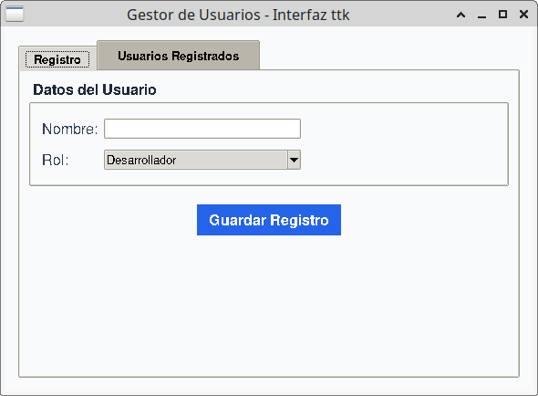

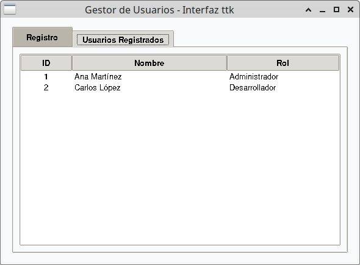


#### Alternativas de Terceros

Si deseas lograr diseños idénticos a aplicaciones web o móviles modernas (con soporte nativo para **Modo Oscuro**, bordes redondeados suaves y sombras) sin escribir reglas de estilo complejas desde cero, existen librerías basadas en Tkinter/`ttk` muy populares:

1. **`ttkbootstrap`**: Aplica temas inspirados en Bootstrap (Flatly, Darkly, Cyborg, Solar) sobre `ttk` estándar simplemente cambiando `import ttkbootstrap as ttk`.
2. **`CustomTkinter`**: Una biblioteca independiente que rediseña por completo los componentes gráficos de Tkinter con estética *Flat Design* contemporánea y cambio automático entre tema claro y oscuro.


### Dark Mode

Aplicar un **tema oscuro (*Dark Mode*)** en Python se puede lograr de tres formas principales, desde la personalización manual con **`ttk.Style`** hasta el uso de librerías modernas como **`ttkbootstrap`** o **`CustomTkinter`**.


#### 1. Tema Oscuro Nativo con `ttk.Style` (Sin librerías externas)

Para crear un tema oscuro en **`ttk`** sin dependencias externas, definimos una paleta de colores oscuros (como tonos gris carbón `#18181b`, `#27272a` y acentos azules `#2563eb`) y los aplicamos mediante el gestor de estilos:

```python
import tkinter as tk
from tkinter import ttk

class AplicacionTemaOscuro(tk.Tk):
    def __init__(self):
        super().__init__()
        self.title("Modo Oscuro Nativo con ttk")
        self.geometry("400x250")
        
        # 1. Definir paleta de colores del tema oscuro
        BG_DARK = "#18181b"       # Fondo principal
        CARD_DARK = "#27272a"     # Fondo de paneles / entradas
        TEXT_LIGHT = "#f4f4f5"    # Texto primario
        ACCENT_BLUE = "#2563eb"   # Color de acento para botones
        
        # 2. Configurar el tema base y los estilos
        self.configure(bg=BG_DARK)
        style = ttk.Style(self)
        style.theme_use("clam")  # "clam" permite personalizar colores limpiamente
        
        # Estilo para Frames y Labels
        style.configure("TFrame", background=BG_DARK)
        style.configure("TLabel", background=BG_DARK, foreground=TEXT_LIGHT, font=("Segoe UI", 10))
        
        # Estilo para campos de entrada (Entry)
        style.configure("TEntry", fieldbackground=CARD_DARK, foreground=TEXT_LIGHT, borderwidth=1)
        
        # Estilo para Botones oscuros con efecto hover
        style.configure("Dark.TButton", background=ACCENT_BLUE, foreground="white", font=("Segoe UI", 10, "bold"), padding=6)
        style.map("Dark.TButton", background=[("active", "#1d4ed8")])

        # 3. Construir la interfaz
        frame = ttk.Frame(self, padding=20)
        frame.pack(fill="both", expand=True)
        
        ttk.Label(frame, text="Iniciar Sesión", font=("Segoe UI", 14, "bold")).pack(pady=(0, 15))
        ttk.Label(frame, text="Usuario:").pack(anchor="w")
        ttk.Entry(frame).pack(fill="x", pady=(2, 10))
        
        ttk.Button(frame, text="Ingresar", style="Dark.TButton").pack(fill="x", pady=10)

if __name__ == "__main__":
    app = AplicacionTemaOscuro()
    app.mainloop()
```


#### Modo Oscuro Instantáneo con `ttkbootstrap`

Si prefieres no configurar cada color manualmente, la librería **`ttkbootstrap`** incluye temas oscuros profesionales ya listos (**`darkly`**, **`cyborg`**, **`solar`**, **`vapor`**):

```python
# Requiere instalación previa: pip install ttkbootstrap
import ttkbootstrap as ttk

# Crear la ventana asignando directamente el tema oscuro
app = ttk.Window(themename="darkly")
app.title("Tema Oscuro con ttkbootstrap")
app.geometry("380x220")

# Los widgets adoptan automáticamente el tema oscuro seleccionado
frame = ttk.Frame(app, padding=20)
frame.pack(fill="both", expand=True)

ttk.Label(frame, text="Panel de Control", font=("Helvetica", 14, "bold")).pack(pady=10)
ttk.Button(frame, text="Acción Principal", bootstyle="primary").pack(fill="x", pady=5)
ttk.Button(frame, text="Modo Peligro", bootstyle="danger-outline").pack(fill="x", pady=5)

app.mainloop()
```


### Crear un tabla ttk.Treeview

El widget **`ttk.Treeview`** es el componente estándar en Tkinter para construir **tablas de datos** de múltiples columnas de forma eficiente, permitiendo la selección de filas, el ordenamiento dinámico por columnas y la integración con barras de desplazamiento (*scrollbars*).

He generado un script completo en Python con **Programación Orientada a Objetos** que implementa una tabla profesional con diseño estilizado, bandas de color alternadas (*zebra striping*) y eventos interactivos. El archivo `tabla_treeview_ttk.py` está listo en tu panel lateral de Studio.


#### Pasos Fundamentales

1. **Definir las columnas y activar el modo tabla:**
   Se pasa la tupla de identificadores de columna al parámetro `columns` y se especifica `show="headings"` para ocultar la columna cero predeterminada (reservada para estructuras jerárquicas de árbol).

2. **Configurar encabezados y formato de celdas:**
   * **`tabla.heading("id_columna", text="Título Visible")`**: Define el texto mostrado en la cabecera.
   * **`tabla.column("id_columna", width=150, anchor="w")`**: Define el ancho en píxeles y la alineación (`"w"` para izquierda, `"center"` para centrado, `"e"` para derecha).

3. **Insertar datos (`insert`):**
   Los datos se agregan pasando una tupla o lista de valores:
   ```python
   tabla.insert("", "end", values=(1, "Laura Gómez", "Desarrolladora", "$3,500"))
   ```

4. **Vincular una barra de desplazamiento (*Scrollbar*):**
   Se conecta la función `tabla.yview` con un widget `ttk.Scrollbar` y se asigna a `yscrollcommand`.

5. **Capturar la selección de filas (Eventos):**
   Se escucha el evento especial **`<<TreeviewSelect>>`** para reaccionar cuando el usuario hace clic sobre un registro.


<details>
<summary>🖥️ Código de ejemplo</summary>

```python
import tkinter as tk
from tkinter import ttk, messagebox

class TablaTreeviewApp(tk.Tk):
    """
    Aplicación modular en Tkinter que demuestra la creación y gestión
    avanzada de tablas con el widget ttk.Treeview.
    """
    def __init__(self):
        super().__init__()
        
        # 1. Configuración de la ventana principal
        self.title("Directorio de Empleados - ttk.Treeview")
        self.geometry("680x420")
        
        # 2. Configurar tema y estilos visuales
        self.style = ttk.Style(self)
        if "clam" in self.style.theme_names():
            self.style.theme_use("clam")
            
        self._configurar_estilos()
        
        # 3. Datos de ejemplo
        self.datos_empleados = [
            (1, "Laura Gómez", "Desarrolladora Senior", "laura.gomez@empresa.com", "$3,500"),
            (2, "Carlos Mendoza", "Analista de Datos", "carlos.mendoza@empresa.com", "$2,800"),
            (3, "Ana Torres", "Diseñadora UX/UI", "ana.torres@empresa.com", "$2,900"),
            (4, "Diego Ramírez", "DevOps Engineer", "diego.ramirez@empresa.com", "$3,800"),
            (5, "Sofia Castro", "Product Owner", "sofia.castro@empresa.com", "$4,100"),
            (6, "Javier Ríos", "QA Specialist", "javier.rios@empresa.com", "$2,600"),
        ]
        
        self._crear_interfaz()
        self._cargar_datos_tabla()

    def _configurar_estilos(self):
        """Define la apariencia visual de los encabezados y filas."""
        self.configure(bg="#f8fafc")
        self.style.configure("TFrame", background="#f8fafc")
        
        # Estilo para los encabezados de la tabla
        self.style.configure(
            "Treeview.Heading",
            font=("Segoe UI", 10, "bold"),
            background="#1e293b",
            foreground="#ffffff",
            padding=6,
            relief="flat"
        )
        self.style.map("Treeview.Heading", background=[("active", "#334155")])
        
        # Estilo para las celdas de contenido
        self.style.configure(
            "Treeview",
            font=("Segoe UI", 9),
            rowheight=26,
            background="#ffffff",
            fieldbackground="#ffffff",
            borderwidth=1
        )
        self.style.map("Treeview", background=[("selected", "#2563eb")], foreground=[("selected", "#ffffff")])

    def _crear_interfaz(self):
        # Título
        tk.Label(
            self, text="Directorio de Empleados", 
            font=("Segoe UI", 14, "bold"), bg="#f8fafc", fg="#0f172a"
        ).pack(pady=(15, 10))
        
        # Contenedor para la tabla y la barra de desplazamiento
        frame_tabla = ttk.Frame(self)
        frame_tabla.pack(fill="both", expand=True, padx=20, pady=5)
        
        # Declaración de columnas
        self.columnas = ("id", "nombre", "cargo", "email", "salario")
        self.tabla = ttk.Treeview(frame_tabla, columns=self.columnas, show="headings", selectmode="browse")
        
        # Encabezados con función de ordenamiento al hacer clic
        self.tabla.heading("id", text="ID", command=lambda: self._ordenar_por("id", False))
        self.tabla.heading("nombre", text="Nombre Completo", command=lambda: self._ordenar_por("nombre", False))
        self.tabla.heading("cargo", text="Cargo / Rol", command=lambda: self._ordenar_por("cargo", False))
        self.tabla.heading("email", text="Correo Electrónico", command=lambda: self._ordenar_por("email", False))
        self.tabla.heading("salario", text="Salario Base", command=lambda: self._ordenar_por("salario", False))
        
        # Configuración de anchos y alineación
        self.tabla.column("id", width=50, anchor="center")
        self.tabla.column("nombre", width=160, anchor="w")
        self.tabla.column("cargo", width=150, anchor="w")
        self.tabla.column("email", width=180, anchor="w")
        self.tabla.column("salario", width=90, anchor="e")
        
        # Barra de desplazamiento vertical (Scrollbar)
        scrollbar_y = ttk.Scrollbar(frame_tabla, orient="vertical", command=self.tabla.yview)
        self.tabla.configure(yscrollcommand=scrollbar_y.set)
        
        self.tabla.grid(row=0, column=0, sticky="nsew")
        scrollbar_y.grid(row=0, column=1, sticky="ns")
        
        frame_tabla.grid_rowconfigure(0, weight=1)
        frame_tabla.grid_columnconfigure(0, weight=1)
        
        # Configuración de bandas de colores alternadas (Zebra Striping)
        self.tabla.tag_configure("par", background="#ffffff")
        self.tabla.tag_configure("impar", background="#f1f5f9")
        
        # Evento de selección de fila
        self.tabla.bind("<<TreeviewSelect>>", self._al_seleccionar_fila)
        
        # Panel inferior de estado
        frame_acciones = ttk.Frame(self)
        frame_acciones.pack(fill="x", padx=20, pady=15)
        
        self.lbl_estado = tk.Label(
            frame_acciones, text="Haz clic sobre una fila para seleccionar un registro.", 
            font=("Segoe UI", 9, "italic"), bg="#f8fafc", fg="#64748b"
        )
        self.lbl_estado.pack(side="left")
        
        ttk.Button(frame_acciones, text="Eliminar Registro", command=self._eliminar_fila).pack(side="right")

    def _cargar_datos_tabla(self):
        """Carga las filas aplicando colores alternados mediante tags."""
        for item in self.tabla.get_children():
            self.tabla.delete(item)
            
        for index, emp in enumerate(self.datos_empleados):
            tag = "impar" if index % 2 != 0 else "par"
            self.tabla.insert("", "end", values=emp, tags=(tag,))

    def _al_seleccionar_fila(self, event):
        """Obtiene y muestra los datos del elemento seleccionado."""
        seleccion = self.tabla.selection()
        if seleccion:
            item_id = seleccion
            valores = self.tabla.item(item_id, "values")
            self.lbl_estado.config(text=f"Seleccionado: {valores} — {valores}")

    def _eliminar_fila(self):
        """Elimina el registro seleccionado."""
        seleccion = self.tabla.selection()
        if not seleccion:
            messagebox.showwarning("Atención", "Selecciona una fila primero.")
            return
            
        item_id = seleccion
        valores = self.tabla.item(item_id, "values")
        if messagebox.askyesno("Confirmar", f"¿Eliminar a '{valores}'?"):
            self.tabla.delete(item_id)
            self.lbl_estado.config(text="Registro eliminado de la interfaz.")

    def _ordenar_por(self, columna, reverso):
        """Ordena el contenido de la tabla al presionar cualquier encabezado."""
        elementos = [(self.tabla.set(k, columna), k) for k in self.tabla.get_children('')]
        
        try:
            elementos.sort(key=lambda x: float(x.replace('$', '').replace(',', '')), reverse=reverso)
        except ValueError:
            elementos.sort(reverse=reverso)

        for index, (val, k) in enumerate(elementos):
            self.tabla.move(k, '', index)
            tag = "impar" if index % 2 != 0 else "par"
            self.tabla.item(k, tags=(tag,))

        # Alternar la dirección para la próxima ordenación
        self.tabla.heading(columna, command=lambda: self._ordenar_por(columna, not reverso))

if __name__ == "__main__":
    app = TablaTreeviewApp()
    app.mainloop()
```
</details>
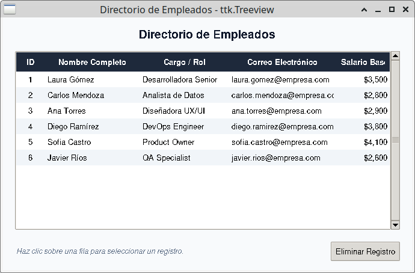


### ttk y bases de datos

La vinculación entre **Tkinter** (la interfaz gráfica de usuario de Python) y una **base de datos** se basa en un patrón de arquitectura desacoplado entre la **capa de presentación (GUI)** y la **capa de persistencia de datos (DB-API)**. 

Tkinter funciona mediante un **bucle de eventos** (*event loop*) que reacciona a las acciones del usuario (como clics en botones o ingreso de texto). Para interactuar con una base de datos, los controladores de eventos (*callbacks*) ejecutan instrucciones mediante un módulo de interfaz de base de datos de Python, como el módulo integrado `sqlite3` o conectores para bases de datos relacionales como `psycopg2` (PostgreSQL) o bibliotecas ORM como SQLAlchemy.


#### Pasos fundamentales

#### 1. Establecer la conexión y crear el cursor
Para iniciar la comunicación con el motor de base de datos relacional (como SQLite), se crea un objeto de conexión mediante `sqlite3.connect()` y posteriormente un objeto **`cursor`**, el cual se encarga de enviar y ejecutar las instrucciones SQL.

#### 2. Capturar los datos desde la interfaz gráfica
Los valores ingresados por el usuario se obtienen desde widgets como `Entry` o mediante variables de control asociadas (`StringVar`, `IntVar`) invocando su método `.get()`.

#### 3. Vincular los eventos de la GUI con las funciones de la base de datos
Se asocian las funciones de manipulación de datos al parámetro `command` de un widget `Button` o mediante la vinculación de eventos con `.bind()`. Al presionar el botón, la función enlazada recoge los valores de la GUI y dispara las operaciones en la base de datos.

#### 4. Ejecutar consultas SQL seguras (Parametrización)
Para ejecutar operaciones de creación (`INSERT`), consulta (`SELECT`), actualización (`UPDATE`) o borrado (`DELETE`), se utiliza el método `cursor.execute()`. **Es una regla crítica de seguridad** utilizar la sustitución implícita de parámetros (con signos `?` en SQLite o `%s` en PostgreSQL) pasando los datos como tuplas, evitando concatenar cadenas de texto directamente para prevenir ataques de **Inyección SQL**.

#### 5. Confirmar transacciones, leer resultados y cerrar la conexión
* **Operaciones de escritura (`INSERT`, `UPDATE`, `DELETE`)**: Se debe invocar `conn.commit()` sobre el objeto de conexión para fijar de manera permanente los cambios en el archivo o servidor.
* **Operaciones de lectura (`SELECT`)**: Se leen las filas resultantes mediante `cursor.fetchall()`, `cursor.fetchone()` o iterando directamente sobre el cursor.
* Al finalizar la transacción o al cerrar la aplicación, se deben cerrar el cursor (`cursor.close()`) y la conexión (`conn.close()`) para liberar los recursos de memoria y del servidor.


#### Ejemplo de integración

A continuación se presenta una estructura completa que ilustra la arquitectura de vinculación entre una interfaz de Tkinter y una base de datos SQLite local:

<details>
<summary>🖥️ Código de integración</summary>

```python
import sqlite3
import tkinter as tk
from tkinter import messagebox

class AplicacionBaseDatos(tk.Tk):
    def __init__(self):
        super().__init__()
        self.title("Gestión de Usuarios con Base de Datos")
        self.geometry("350x250")
        
        # 1. Crear la base de datos y la tabla si no existen
        self._inicializar_db()
        
        # 2. Variables de control conectadas a la GUI
        self.var_nombre = tk.StringVar()
        self.var_email = tk.StringVar()
        
        # 3. Construcción de widgets de la interfaz
        tk.Label(self, text="Nombre:").pack(pady=(15, 2))
        tk.Entry(self, textvariable=self.var_nombre).pack(fill="x", padx=20)
        
        tk.Label(self, text="Email:").pack(pady=(10, 2))
        tk.Entry(self, textvariable=self.var_email).pack(fill="x", padx=20)
        
        # Eventos vinculados a los botones mediante el parámetro command
        tk.Button(self, text="Guardar en Base de Datos", command=self._guardar_usuario).pack(pady=15)
        tk.Button(self, text="Consultar Registros", command=self._consultar_usuarios).pack()

    def _inicializar_db(self):
        """Abre la conexión y crea la estructura inicial de tablas."""
        conn = sqlite3.connect("usuarios_app.db")
        cursor = conn.cursor()
        cursor.execute("""
            CREATE TABLE IF NOT EXISTS usuarios (
                id INTEGER PRIMARY KEY AUTOINCREMENT,
                nombre TEXT NOT NULL,
                email TEXT NOT NULL
            )
        """)
        conn.commit()
        conn.close()

    def _guardar_usuario(self):
        """Lee la GUI y ejecuta una inserción SQL parametrizada."""
        nombre = self.var_nombre.get().strip()
        email = self.var_email.get().strip()
        
        if not nombre or not email:
            messagebox.showwarning("Atención", "Por favor completa todos los campos.")
            return
            
        # Conexión, inserción parametrizada y commit
        conn = sqlite3.connect("usuarios_app.db")
        cursor = conn.cursor()
        cursor.execute(
            "INSERT INTO usuarios (nombre, email) VALUES (?, ?)", 
            (nombre, email)
        )
        conn.commit()
        conn.close()
        
        messagebox.showinfo("Éxito", "Usuario registrado correctamente en la base de datos.")
        self.var_nombre.set("")
        self.var_email.set("")

    def _consultar_usuarios(self):
        """Consulta la base de datos y recupera todos los registros."""
        conn = sqlite3.connect("usuarios_app.db")
        cursor = conn.cursor()
        cursor.execute("SELECT id, nombre, email FROM usuarios")
        registros = cursor.fetchall()
        conn.close()
        
        # Formatear y mostrar los resultados obtenidos
        resumen = "\n".join([f"[{r}] {r} - {r}" for r in registros])
        if resumen:
            messagebox.showinfo("Usuarios Registrados", resumen)
        else:
            messagebox.showinfo("Sin Datos", "No existen registros guardados.")

if __name__ == "__main__":
    app = AplicacionBaseDatos()
    app.mainloop()
```
</details>
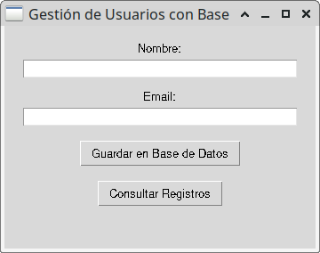


***
## **CustomTkinter**

**CustomTkinter** es una biblioteca de Python construida como una extensión sobre **Tkinter** que permite crear **Interfaces Gráficas de Usuario (GUI)** con un aspecto moderno, estilizado y contemporáneo (*Flat Design*).

A diferencia de los widgets tradicionales de Tkinter (que mantienen la apariencia estética clásica de los años 90), CustomTkinter rediseña todos los controles gráficos añadiendo **esquinas redondeadas**, **sombras**, **soporte nativo para Modo Oscuro y Modo Claro**, y **escalado automático para pantallas de alta densidad (HiDPI / Retina)** en Windows, macOS y Linux.

---

### Características principales

* **Widgets modernos nativos (`CTk`):** Proporciona equivalentes mejorados para casi todos los elementos estándar de Tkinter (`CTkButton`, `CTkEntry`, `CTkLabel`, `CTkFrame`, `CTkOptionMenu`, `CTkCheckBox`, `CTkSwitch`, `CTkProgressBar`, etc.).

* **Gestión de Apariencia Simplificada:** Permite alternar dinámicamente entre **`"Dark"`**, **`"Light"`** o el modo predeterminado del sistema (**`"System"`**) con una sola línea de código (`ctk.set_appearance_mode("Dark")`).

* **Temas de Color Personalizables:** Ofrece temas predefinidos (`blue`, `green`, `dark-blue`) y permite cargar paletas de colores en archivos `.json`.

* **Paneles desplazables avanzables (`CTkScrollableFrame`):** Un contenedor nativo con barras de desplazamiento estilizadas, ideal para construir **listas dinámicas, tarjetas de contenido y tablas de datos**.


### Uso en Ingreso de Datos

Para construir formularios de entrada de datos seguros y estilizados, CustomTkinter utiliza componentes específicos:

* **`CTkEntry`:** Cajas de texto de una línea con bordes redondeados y texto de sugerencia (*placeholder_text*).
* **`CTkOptionMenu` / `CTkComboBox`:** Menús desplegables para seleccionar opciones predefinidas.
* **`CTkSwitch` / `CTkCheckBox`:** Interruptores de estado (activo/inactivo) o casillas de verificación.
* **`CTkButton`:** Botones interactivos con colores de fondo (`fg_color`), colores al pasar el cursor (`hover_color`) y bordes suavizados.


### Uso en Lista de Resultados

Existen dos estrategias principales para mostrar listas o tablas de datos con CustomTkinter:

#### **Enfoque A: Tabla Nativa con `CTkScrollableFrame` (Recomendado)**
Utiliza un panel desplazable (`CTkScrollableFrame`) organizado con un sistema de cuadrícula (`grid`). Cada registro se dibuja como una fila de etiquetas (`CTkLabel`) y botones de acción (editar/eliminar). 
* **Ventaja:** Mantiene una integración visual del 100% con los bordes redondeados, colores del tema y el cambio dinámico entre modo claro y oscuro.

#### **Enfoque B: Contenedor con `ttk.Treeview`**
Integra el widget tradicional de tabla multi-columna de `ttk.Treeview` dentro de un panel `CTkFrame`.
* **Ventaja:** Ideal para conjuntos masivos de datos tabulares tradicionales con ordenamiento por encabezados.


**`CustomTkinter`** es la opción más popular hoy en día para aplicaciones de escritorio con estética moderna (*Flat Design*). Soporta cambio dinámico entre modo claro y oscuro con una sola línea de código:

<details>
<summary>🖥️ Código de tema dark</summary>

```python
# Tema Oscuro con CustomTkinter
# Requiere instalación previa: pip install customtkinter
import customtkinter as ctk

# Configuración global del tema oscuro
ctk.set_appearance_mode("Dark")       # Opciones: "System", "Dark", "Light"
ctk.set_default_color_theme("blue")   # Opciones: "blue", "green", "dark-blue"
# set default font to roboto
default_font = ("Helvetica", 14)
bold_font = ("Helvetica", 16, "bold")

app = ctk.CTk()
app.title("Modo Oscuro con CustomTkinter")
app.geometry("400x260")

frame = ctk.CTkFrame(app, corner_radius=10)
frame.pack(padx=20, pady=20, fill="both", expand=True)

label = ctk.CTkLabel(frame, text="Bienvenido al Modo Oscuro", font=bold_font)
label.pack(pady=15)

entry = ctk.CTkEntry(frame, placeholder_text="Escribe algo aquí...", font=default_font)
entry.pack(pady=10, fill="x", padx=15)

btn = ctk.CTkButton(frame, text="Guardar Cambios", font=default_font)
btn.pack(pady=10)

app.mainloop()
```
</details>
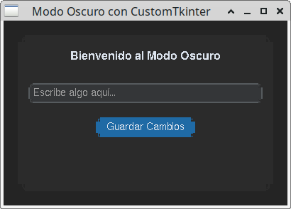


### Ejemplo de aplicación registro

Un script completo en Python con **Programación Orientada a Objetos** que implementa un **Formulario de Ingreso de Datos** en el panel izquierdo y una **Tabla de Resultados Dinámica** en el panel derecho con cambio instantáneo entre Modo Claro y Modo Oscuro.

<Tabs>
<TabItem value="ej1" label="tkinter" default>
<div class="alert alert--primary">
**Formulario y Tabla de Resultados**

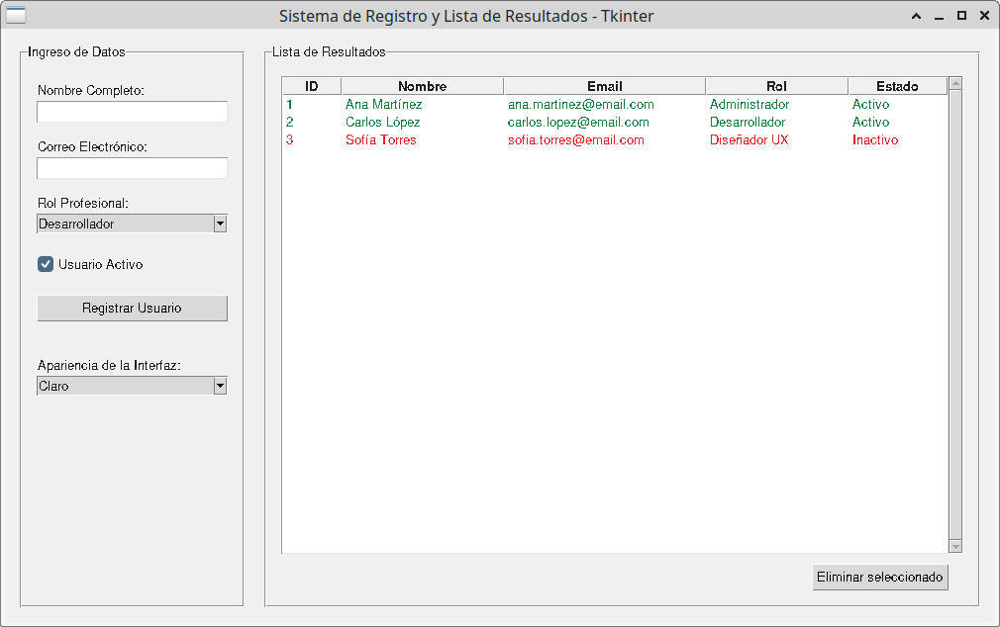

</div>
</TabItem>
<TabItem value="ej1-python" label="🖥️ Código tkinter" >

```python showLineNumbers
import tkinter as tk
from tkinter import messagebox, ttk


class AppGestionTkinter(tk.Tk):
    """Formulario de registro y lista de usuarios con widgets estándar de Tkinter."""

    def __init__(self):
        super().__init__()

        self.title("Sistema de Registro y Lista de Resultados - Tkinter")
        self.geometry("1000x600")
        self.minsize(850, 500)

        self.registros = [
            {"id": 1, "nombre": "Ana Martínez", "email": "ana.martinez@email.com", "rol": "Administrador", "estado": "Activo"},
            {"id": 2, "nombre": "Carlos López", "email": "carlos.lopez@email.com", "rol": "Desarrollador", "estado": "Activo"},
            {"id": 3, "nombre": "Sofía Torres", "email": "sofia.torres@email.com", "rol": "Diseñador UX", "estado": "Inactivo"},
        ]
        self.contador_id = 4
        self.estilo = ttk.Style(self)

        self.grid_columnconfigure(0, weight=1)
        self.grid_columnconfigure(1, weight=2)
        self.grid_rowconfigure(0, weight=1)

        self._crear_panel_formulario()
        self._crear_panel_tabla()
        self._cargar_datos_tabla()
        self._cambiar_apariencia("Claro")

    def _crear_panel_formulario(self):
        self.frame_form = ttk.LabelFrame(self, text="Ingreso de Datos", padding=15)
        self.frame_form.grid(row=0, column=0, padx=(15, 10), pady=15, sticky="nsew")
        self.frame_form.columnconfigure(0, weight=1)

        ttk.Label(self.frame_form, text="Nombre Completo:").grid(row=0, column=0, sticky="w", pady=(5, 2))
        self.ent_nombre = ttk.Entry(self.frame_form)
        self.ent_nombre.grid(row=1, column=0, sticky="ew", pady=(0, 10))

        ttk.Label(self.frame_form, text="Correo Electrónico:").grid(row=2, column=0, sticky="w", pady=(5, 2))
        self.ent_email = ttk.Entry(self.frame_form)
        self.ent_email.grid(row=3, column=0, sticky="ew", pady=(0, 10))

        ttk.Label(self.frame_form, text="Rol Profesional:").grid(row=4, column=0, sticky="w", pady=(5, 2))
        self.opt_rol = ttk.Combobox(
            self.frame_form,
            values=["Desarrollador", "Administrador", "Diseñador UX", "Analista de Datos"],
            state="readonly",
        )
        self.opt_rol.current(0)
        self.opt_rol.grid(row=5, column=0, sticky="ew", pady=(0, 10))

        self.estado_activo = tk.BooleanVar(value=True)
        ttk.Checkbutton(
            self.frame_form,
            text="Usuario Activo",
            variable=self.estado_activo,
        ).grid(row=6, column=0, sticky="w", pady=(10, 15))

        ttk.Button(
            self.frame_form,
            text="Registrar Usuario",
            command=self._agregar_registro,
        ).grid(row=7, column=0, sticky="ew", pady=(5, 10))

        ttk.Label(self.frame_form, text="Apariencia de la Interfaz:").grid(
            row=8, column=0, sticky="w", pady=(25, 2)
        )
        self.opt_tema = ttk.Combobox(
            self.frame_form,
            values=["Claro", "Oscuro"],
            state="readonly",
        )
        self.opt_tema.set("Claro")
        self.opt_tema.bind("<<ComboboxSelected>>", self._cambiar_apariencia)
        self.opt_tema.grid(row=9, column=0, sticky="ew", pady=(0, 15))

    def _crear_panel_tabla(self):
        self.frame_tabla = ttk.LabelFrame(self, text="Lista de Resultados", padding=15)
        self.frame_tabla.grid(row=0, column=1, padx=(10, 15), pady=15, sticky="nsew")
        self.frame_tabla.columnconfigure(0, weight=1)
        self.frame_tabla.rowconfigure(0, weight=1)

        columnas = ("id", "nombre", "email", "rol", "estado")
        self.tabla = ttk.Treeview(
            self.frame_tabla,
            columns=columnas,
            show="headings",
            selectmode="browse",
        )
        titulos = {
            "id": "ID",
            "nombre": "Nombre",
            "email": "Email",
            "rol": "Rol",
            "estado": "Estado",
        }
        anchos = {"id": 45, "nombre": 150, "email": 190, "rol": 130, "estado": 85}
        for columna in columnas:
            self.tabla.heading(columna, text=titulos[columna])
            self.tabla.column(columna, width=anchos[columna], minwidth=50, anchor="w")

        self.tabla.tag_configure("activo", foreground="#15803d")
        self.tabla.tag_configure("inactivo", foreground="#dc2626")
        self.tabla.grid(row=0, column=0, sticky="nsew")

        barra = ttk.Scrollbar(self.frame_tabla, orient="vertical", command=self.tabla.yview)
        barra.grid(row=0, column=1, sticky="ns")
        self.tabla.configure(yscrollcommand=barra.set)

        ttk.Button(
            self.frame_tabla,
            text="Eliminar seleccionado",
            command=self._eliminar_registro_seleccionado,
        ).grid(row=1, column=0, sticky="e", pady=(10, 0))

    def _cargar_datos_tabla(self):
        for fila in self.tabla.get_children():
            self.tabla.delete(fila)

        for item in self.registros:
            etiqueta = "activo" if item["estado"] == "Activo" else "inactivo"
            self.tabla.insert(
                "",
                "end",
                iid=str(item["id"]),
                values=(item["id"], item["nombre"], item["email"], item["rol"], item["estado"]),
                tags=(etiqueta,),
            )

    def _agregar_registro(self):
        nombre = self.ent_nombre.get().strip()
        email = self.ent_email.get().strip()

        if not nombre or not email:
            messagebox.showwarning("Campos Incompletos", "Por favor completa el nombre y el correo.")
            return

        self.registros.append({
            "id": self.contador_id,
            "nombre": nombre,
            "email": email,
            "rol": self.opt_rol.get(),
            "estado": "Activo" if self.estado_activo.get() else "Inactivo",
        })
        self.contador_id += 1

        self._cargar_datos_tabla()
        self.ent_nombre.delete(0, tk.END)
        self.ent_email.delete(0, tk.END)
        messagebox.showinfo("Éxito", f"Usuario '{nombre}' registrado correctamente.")

    def _eliminar_registro_seleccionado(self):
        seleccion = self.tabla.selection()
        if not seleccion:
            messagebox.showwarning("Sin selección", "Selecciona un usuario para eliminarlo.")
            return

        id_registro = int(seleccion[0])
        self.registros = [registro for registro in self.registros if registro["id"] != id_registro]
        self._cargar_datos_tabla()

    def _cambiar_apariencia(self, evento=None):
        oscuro = self.opt_tema.get() == "Oscuro"
        fondo = "#252525" if oscuro else "#f0f0f0"
        texto = "#f5f5f5" if oscuro else "#202020"
        campo = "#333333" if oscuro else "#ffffff"

        self.configure(bg=fondo)
        self.estilo.configure("TFrame", background=fondo)
        self.estilo.configure("TLabelframe", background=fondo, foreground=texto)
        self.estilo.configure("TLabelframe.Label", background=fondo, foreground=texto)
        self.estilo.configure("TLabel", background=fondo, foreground=texto)
        self.estilo.configure("TCheckbutton", background=fondo, foreground=texto)
        self.estilo.map("TCheckbutton", background=[("active", fondo)])
        self.estilo.configure("TEntry", fieldbackground=campo, foreground=texto)
        self.estilo.configure("TCombobox", fieldbackground=campo, foreground=texto)
        self.estilo.configure(
            "Treeview",
            background=campo,
            fieldbackground=campo,
            foreground=texto,
        )
        self.estilo.configure("Treeview.Heading", background=fondo, foreground=texto)
        self.estilo.map(
            "Treeview",
            background=[("selected", "#2563eb")],
            foreground=[("selected", "#ffffff")],
        )


if __name__ == "__main__":
    app = AppGestionTkinter()
    app.mainloop()
```
</TabItem>
</Tabs>

<Tabs>
<TabItem value="ej2" label="customtkinter" default>
<div class="alert alert--primary">
**Formulario y Tabla de Resultados**

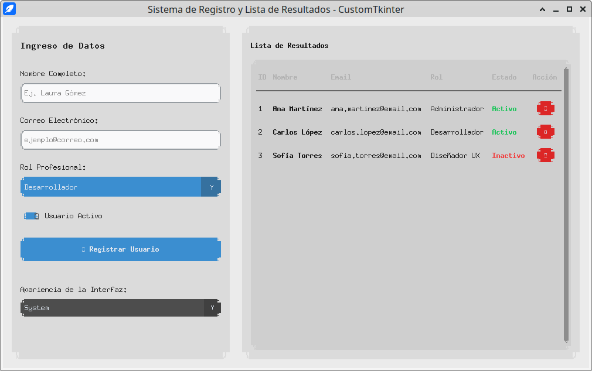

</div>
</TabItem>
<TabItem value="ej2-python" label="🖥️ Código customtkinter" >

```python showLineNumbers
import tkinter as tk
from tkinter import messagebox
import customtkinter as ctk

# Configuración global del tema y la apariencia
ctk.set_appearance_mode("System")  # Opciones: "System", "Dark", "Light"
ctk.set_default_color_theme("blue") # Opciones: "blue", "green", "dark-blue"

class AppGestionCustomTkinter(ctk.CTk):
    """
    Aplicación de escritorio desarrollada con CustomTkinter que integra:
    1. Formulario de ingreso de datos (Data Entry) estilizado.
    2. Tabla de resultados/registros utilizando CTkScrollableFrame.
    """

    def __init__(self):
        super().__init__()

        # 1. Configuración de la ventana principal
        self.title("Sistema de Registro y Lista de Resultados - CustomTkinter")
        self.geometry("1000x600")
        self.minsize(850, 500)

        # Datos en memoria
        self.registros = [
            {"id": 1, "nombre": "Ana Martínez", "email": "ana.martinez@email.com", "rol": "Administrador", "estado": "Activo"},
            {"id": 2, "nombre": "Carlos López", "email": "carlos.lopez@email.com", "rol": "Desarrollador", "estado": "Activo"},
            {"id": 3, "nombre": "Sofía Torres", "email": "sofia.torres@email.com", "rol": "Diseñador UX", "estado": "Inactivo"},
        ]
        self.contador_id = 4

        # 2. Estructura del Layout principal (Grid de 2 columnas)
        self.grid_columnconfigure(0, weight=1)  # Columna 0: Formulario (Panel Izquierdo)
        self.grid_columnconfigure(1, weight=2)  # Columna 1: Tabla de Resultados (Panel Derecho)
        self.grid_rowconfigure(0, weight=1)

        # 3. Construcción de los paneles
        self._crear_panel_formulario()
        self._crear_panel_tabla()
        self._cargar_datos_tabla()

    def _crear_panel_formulario(self):
        """Crea el panel izquierdo para el ingreso de datos (Data Entry)."""
        self.frame_form = ctk.CTkFrame(self, corner_radius=12)
        self.frame_form.grid(row=0, column=0, padx=(15, 10), pady=15, sticky="nsew")

        # Título del Formulario
        lbl_titulo = ctk.CTkLabel(
            self.frame_form,
            text="Ingreso de Datos",
            font=ctk.CTkFont(family="Roboto", size=18, weight="bold")
        )
        lbl_titulo.pack(padx=15, pady=(20, 15), anchor="w")

        # Campo: Nombre Completo
        lbl_nombre = ctk.CTkLabel(self.frame_form, text="Nombre Completo:", font=ctk.CTkFont(size=12))
        lbl_nombre.pack(padx=15, pady=(5, 2), anchor="w")

        self.ent_nombre = ctk.CTkEntry(
            self.frame_form,
            placeholder_text="Ej. Laura Gómez",
            height=35
        )
        self.ent_nombre.pack(padx=15, pady=(0, 10), fill="x")

        # Campo: Correo Electrónico
        lbl_email = ctk.CTkLabel(self.frame_form, text="Correo Electrónico:", font=ctk.CTkFont(size=12))
        lbl_email.pack(padx=15, pady=(5, 2), anchor="w")

        self.ent_email = ctk.CTkEntry(
            self.frame_form,
            placeholder_text="ejemplo@correo.com",
            height=35
        )
        self.ent_email.pack(padx=15, pady=(0, 10), fill="x")

        # Campo: Rol Profesional (Dropdown Menu)
        lbl_rol = ctk.CTkLabel(self.frame_form, text="Rol Profesional:", font=ctk.CTkFont(size=12))
        lbl_rol.pack(padx=15, pady=(5, 2), anchor="w")

        self.opt_rol = ctk.CTkOptionMenu(
            self.frame_form,
            values=["Desarrollador", "Administrador", "Diseñador UX", "Analista de Datos"],
            height=35
        )
        self.opt_rol.pack(padx=15, pady=(0, 10), fill="x")

        # Campo: Estado (Switch de CustomTkinter)
        self.switch_estado = ctk.CTkSwitch(
            self.frame_form,
            text="Usuario Activo",
            font=ctk.CTkFont(size=12)
        )
        self.switch_estado.select()
        self.switch_estado.pack(padx=15, pady=(10, 15), anchor="w")

        # Botón de Guardar Registro
        btn_guardar = ctk.CTkButton(
            self.frame_form,
            text="➕ Registrar Usuario",
            font=ctk.CTkFont(size=13, weight="bold"),
            height=40,
            command=self._agregar_registro
        )
        btn_guardar.pack(padx=15, pady=(10, 10), fill="x")

        # Selector de Apariencia (Modo Claro / Oscuro / Sistema)
        lbl_tema = ctk.CTkLabel(self.frame_form, text="Apariencia de la Interfaz:", font=ctk.CTkFont(size=11))
        lbl_tema.pack(padx=15, pady=(25, 2), anchor="w")

        self.opt_tema = ctk.CTkOptionMenu(
            self.frame_form,
            values=["System", "Dark", "Light"],
            command=self._cambiar_apariencia,
            height=30,
            fg_color="gray30",
            button_color="gray25"
        )
        self.opt_tema.pack(padx=15, pady=(0, 15), fill="x")

    def _crear_panel_tabla(self):
        """Crea el panel derecho para visualizar la lista de resultados en formato Tabla."""
        self.frame_tabla = ctk.CTkFrame(self, corner_radius=12)
        self.frame_tabla.grid(row=0, column=1, padx=(10, 15), pady=15, sticky="nsew")

        self.frame_tabla.grid_columnconfigure(0, weight=1)
        self.frame_tabla.grid_rowconfigure(1, weight=1)

        # Encabezado del Panel
        lbl_titulo_tabla = ctk.CTkLabel(
            self.frame_tabla,
            text="Lista de Resultados",
            font=ctk.CTkFont(family="Roboto", size=18, weight="bold")
        )
        lbl_titulo_tabla.grid(row=0, column=0, padx=15, pady=(20, 10), sticky="w")

        # Tabla Nativa con CTkScrollableFrame
        self.scroll_tabla = ctk.CTkScrollableFrame(self.frame_tabla, corner_radius=8)
        self.scroll_tabla.grid(row=1, column=0, padx=15, pady=(0, 15), sticky="nsew")

        # Configurar proporciones de las columnas
        self.scroll_tabla.grid_columnconfigure(0, weight=1)  # ID
        self.scroll_tabla.grid_columnconfigure(1, weight=3)  # Nombre
        self.scroll_tabla.grid_columnconfigure(2, weight=4)  # Email
        self.scroll_tabla.grid_columnconfigure(3, weight=3)  # Rol
        self.scroll_tabla.grid_columnconfigure(4, weight=2)  # Estado
        self.scroll_tabla.grid_columnconfigure(5, weight=1)  # Acción

        # Cabeceras de la Tabla
        cabeceras = ["ID", "Nombre", "Email", "Rol", "Estado", "Acción"]
        for col_idx, texto in enumerate(cabeceras):
            lbl_cabecera = ctk.CTkLabel(
                self.scroll_tabla,
                text=texto,
                font=ctk.CTkFont(size=12, weight="bold"),
                text_color="gray70"
            )
            lbl_cabecera.grid(row=0, column=col_idx, padx=5, pady=8, sticky="w")

        # Línea divisoria
        sep = ctk.CTkFrame(self.scroll_tabla, height=2, fg_color="gray40")
        sep.grid(row=1, column=0, columnspan=6, sticky="ew", pady=(0, 10))

    def _cargar_datos_tabla(self):
        """Renderiza dinámicamente las filas dentro de la tabla."""
        # Limpiar filas existentes
        for widget in self.scroll_tabla.winfo_children():
            if widget.grid_info().get("row", 0) > 1:
                widget.destroy()

        # Insertar registros
        for idx, item in enumerate(self.registros, start=2):
            lbl_id = ctk.CTkLabel(self.scroll_tabla, text=str(item["id"]), font=ctk.CTkFont(size=12))
            lbl_id.grid(row=idx, column=0, padx=5, pady=6, sticky="w")

            lbl_nom = ctk.CTkLabel(self.scroll_tabla, text=item["nombre"], font=ctk.CTkFont(size=12, weight="bold"))
            lbl_nom.grid(row=idx, column=1, padx=5, pady=6, sticky="w")

            lbl_email = ctk.CTkLabel(self.scroll_tabla, text=item["email"], font=ctk.CTkFont(size=12))
            lbl_email.grid(row=idx, column=2, padx=5, pady=6, sticky="w")

            lbl_rol = ctk.CTkLabel(self.scroll_tabla, text=item["rol"], font=ctk.CTkFont(size=12))
            lbl_rol.grid(row=idx, column=3, padx=5, pady=6, sticky="w")

            color_estado = "#22c55e" if item["estado"] == "Activo" else "#ef4444"
            lbl_est = ctk.CTkLabel(self.scroll_tabla, text=item["estado"], font=ctk.CTkFont(size=11, weight="bold"), text_color=color_estado)
            lbl_est.grid(row=idx, column=4, padx=5, pady=6, sticky="w")

            # Botón eliminar
            btn_borrar = ctk.CTkButton(
                self.scroll_tabla,
                text="🗑️",
                width=30,
                height=25,
                fg_color="#dc2626",
                hover_color="#991b1b",
                command=lambda id_reg=item["id"]: self._eliminar_registro(id_reg)
            )
            btn_borrar.grid(row=idx, column=5, padx=5, pady=6)

    def _agregar_registro(self):
        """Procesa y valida el ingreso de un nuevo registro."""
        nombre = self.ent_nombre.get().strip()
        email = self.ent_email.get().strip()
        rol = self.opt_rol.get()
        estado = "Activo" if self.switch_estado.get() == 1 else "Inactivo"

        if not nombre or not email:
            messagebox.showwarning("Campos Incompletos", "Por favor completa el nombre y el correo.")
            return

        nuevo_registro = {
            "id": self.contador_id,
            "nombre": nombre,
            "email": email,
            "rol": rol,
            "estado": estado
        }

        self.registros.append(nuevo_registro)
        self.contador_id += 1

        self._cargar_datos_tabla()
        self.ent_nombre.delete(0, tk.END)
        self.ent_email.delete(0, tk.END)
        messagebox.showinfo("Éxito", f"Usuario '{nombre}' registrado correctamente.")

    def _eliminar_registro(self, id_registro):
        """Elimina un registro de la lista de resultados."""
        self.registros = [r for r in self.registros if r["id"] != id_registro]
        self._cargar_datos_tabla()

    def _cambiar_apariencia(self, nuevo_modo):
        """Cambia el modo claro / oscuro en tiempo de ejecución."""
        ctk.set_appearance_mode(nuevo_modo)

if __name__ == "__main__":
    app = AppGestionCustomTkinter()
    app.mainloop()
```
</TabItem>
</Tabs>

<Tabs>
<TabItem value="ej3" label="ttkbootstrap" default>
<div class="alert alert--primary">
**Formulario y Tabla de Resultados**

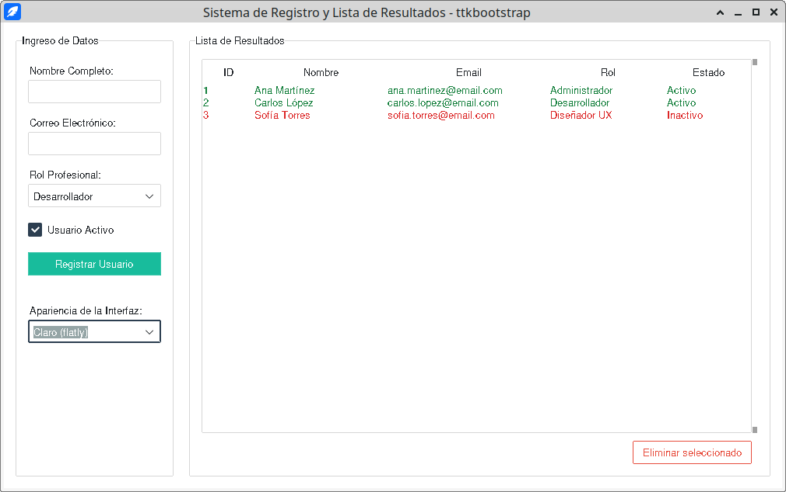

</div>
</TabItem>
<TabItem value="ej3-python" label="🖥️ Código ttkbootstrap" >

```python showLineNumbers
import tkinter as tk
from tkinter import messagebox

import ttkbootstrap as ttk


class AppGestionTkinter(ttk.Window):
    """Formulario de registro y lista de usuarios con ttkbootstrap."""

    def __init__(self):
        super().__init__(themename="flatly")

        self.title("Sistema de Registro y Lista de Resultados - ttkbootstrap")
        self.geometry("1000x600")
        self.minsize(850, 500)

        self.registros = [
            {"id": 1, "nombre": "Ana Martínez", "email": "ana.martinez@email.com", "rol": "Administrador", "estado": "Activo"},
            {"id": 2, "nombre": "Carlos López", "email": "carlos.lopez@email.com", "rol": "Desarrollador", "estado": "Activo"},
            {"id": 3, "nombre": "Sofía Torres", "email": "sofia.torres@email.com", "rol": "Diseñador UX", "estado": "Inactivo"},
        ]
        self.contador_id = 4
        self.grid_columnconfigure(0, weight=1)
        self.grid_columnconfigure(1, weight=2)
        self.grid_rowconfigure(0, weight=1)

        self._crear_panel_formulario()
        self._crear_panel_tabla()
        self._cargar_datos_tabla()
        self._cambiar_apariencia()

    def _crear_panel_formulario(self):
        self.frame_form = ttk.LabelFrame(self, text="Ingreso de Datos", padding=15)
        self.frame_form.grid(row=0, column=0, padx=(15, 10), pady=15, sticky="nsew")
        self.frame_form.columnconfigure(0, weight=1)

        ttk.Label(self.frame_form, text="Nombre Completo:").grid(row=0, column=0, sticky="w", pady=(5, 2))
        self.ent_nombre = ttk.Entry(self.frame_form)
        self.ent_nombre.grid(row=1, column=0, sticky="ew", pady=(0, 10))

        ttk.Label(self.frame_form, text="Correo Electrónico:").grid(row=2, column=0, sticky="w", pady=(5, 2))
        self.ent_email = ttk.Entry(self.frame_form)
        self.ent_email.grid(row=3, column=0, sticky="ew", pady=(0, 10))

        ttk.Label(self.frame_form, text="Rol Profesional:").grid(row=4, column=0, sticky="w", pady=(5, 2))
        self.opt_rol = ttk.Combobox(
            self.frame_form,
            values=["Desarrollador", "Administrador", "Diseñador UX", "Analista de Datos"],
            state="readonly",
        )
        self.opt_rol.current(0)
        self.opt_rol.grid(row=5, column=0, sticky="ew", pady=(0, 10))

        self.estado_activo = tk.BooleanVar(value=True)
        ttk.Checkbutton(
            self.frame_form,
            text="Usuario Activo",
            variable=self.estado_activo,
        ).grid(row=6, column=0, sticky="w", pady=(10, 15))

        ttk.Button(
            self.frame_form,
            text="Registrar Usuario",
            command=self._agregar_registro,
            bootstyle="success",
        ).grid(row=7, column=0, sticky="ew", pady=(5, 10))

        ttk.Label(self.frame_form, text="Apariencia de la Interfaz:").grid(
            row=8, column=0, sticky="w", pady=(25, 2)
        )
        self.opt_tema = ttk.Combobox(
            self.frame_form,
            values=["Claro (flatly)", "Oscuro (darkly)"],
            state="readonly",
        )
        self.opt_tema.set("Claro (flatly)")
        self.opt_tema.bind("<<ComboboxSelected>>", self._cambiar_apariencia)
        self.opt_tema.grid(row=9, column=0, sticky="ew", pady=(0, 15))

    def _crear_panel_tabla(self):
        self.frame_tabla = ttk.LabelFrame(self, text="Lista de Resultados", padding=15)
        self.frame_tabla.grid(row=0, column=1, padx=(10, 15), pady=15, sticky="nsew")
        self.frame_tabla.columnconfigure(0, weight=1)
        self.frame_tabla.rowconfigure(0, weight=1)

        columnas = ("id", "nombre", "email", "rol", "estado")
        self.tabla = ttk.Treeview(
            self.frame_tabla,
            columns=columnas,
            show="headings",
            selectmode="browse",
        )
        titulos = {
            "id": "ID",
            "nombre": "Nombre",
            "email": "Email",
            "rol": "Rol",
            "estado": "Estado",
        }
        anchos = {"id": 45, "nombre": 150, "email": 190, "rol": 130, "estado": 85}
        for columna in columnas:
            self.tabla.heading(columna, text=titulos[columna])
            self.tabla.column(columna, width=anchos[columna], minwidth=50, anchor="w")

        self.tabla.tag_configure("activo", foreground="#15803d")
        self.tabla.tag_configure("inactivo", foreground="#dc2626")
        self.tabla.grid(row=0, column=0, sticky="nsew")

        barra = ttk.Scrollbar(self.frame_tabla, orient="vertical", command=self.tabla.yview)
        barra.grid(row=0, column=1, sticky="ns")
        self.tabla.configure(yscrollcommand=barra.set)

        ttk.Button(
            self.frame_tabla,
            text="Eliminar seleccionado",
            command=self._eliminar_registro_seleccionado,
            bootstyle="danger-outline",
        ).grid(row=1, column=0, sticky="e", pady=(10, 0))

    def _cargar_datos_tabla(self):
        for fila in self.tabla.get_children():
            self.tabla.delete(fila)

        for item in self.registros:
            etiqueta = "activo" if item["estado"] == "Activo" else "inactivo"
            self.tabla.insert(
                "",
                "end",
                iid=str(item["id"]),
                values=(item["id"], item["nombre"], item["email"], item["rol"], item["estado"]),
                tags=(etiqueta,),
            )

    def _agregar_registro(self):
        nombre = self.ent_nombre.get().strip()
        email = self.ent_email.get().strip()

        if not nombre or not email:
            messagebox.showwarning("Campos Incompletos", "Por favor completa el nombre y el correo.")
            return

        self.registros.append({
            "id": self.contador_id,
            "nombre": nombre,
            "email": email,
            "rol": self.opt_rol.get(),
            "estado": "Activo" if self.estado_activo.get() else "Inactivo",
        })
        self.contador_id += 1

        self._cargar_datos_tabla()
        self.ent_nombre.delete(0, tk.END)
        self.ent_email.delete(0, tk.END)
        messagebox.showinfo("Éxito", f"Usuario '{nombre}' registrado correctamente.")

    def _eliminar_registro_seleccionado(self):
        seleccion = self.tabla.selection()
        if not seleccion:
            messagebox.showwarning("Sin selección", "Selecciona un usuario para eliminarlo.")
            return

        id_registro = int(seleccion[0])
        self.registros = [registro for registro in self.registros if registro["id"] != id_registro]
        self._cargar_datos_tabla()

    def _cambiar_apariencia(self, evento=None):
        tema = "darkly" if self.opt_tema.get().startswith("Oscuro") else "flatly"
        self.style.theme_use(tema)


if __name__ == "__main__":
    app = AppGestionTkinter()
    app.mainloop()
```
</TabItem>
</Tabs>
<br/>
---


### Resumen Comparativo

* **`ttk` Nativo:** Ideal si no quieres instalar dependencias externas en tu proyecto Python.

* **`ttkbootstrap`:** La mejor opción para prototipado rápido con temas profesionales estilo Bootstrap.

* **`CustomTkinter`:** La mejor alternativa si buscas bordes redondeados, sombras y soporte para cambiar entre tema claro y oscuro automáticamente según la configuración del sistema operativo.


***
## **ttkbootstrap**

**`ttkbootstrap`** es una biblioteca de Python diseñada para transformar de forma instantánea la apariencia de las aplicaciones de escritorio creadas con **Tkinter**. 

Funciona como una capa superior (*wrapper*) construida sobre el módulo de widgets temáticos **`tkinter.ttk`**, incorporando los principios de diseño, la paleta de colores y la semántica visual del popular marco de trabajo web **[Bootstrap](https://getbootstrap.com/)** (versiones 4 y 5).


### Por qué usar `ttkbootstrap`

1. **Catálogo de Temas Listos para Usar (*Themes*):**
   Permite cambiar todo el aspecto visual de la aplicación asignando el nombre de un tema al instanciar la ventana principal (`ttk.Window(themename="superhero")`).
   * **Temas Claros:** `flatly`, `cosmo`, `journal`, `minty`, `litera`, `pulse`, `lumen`, `sandstone`.
   * **Temas Oscuros:** `darkly`, `cyborg`, `superhero`, `solar`, `vapor`.

2. **Parámetro Semántico `bootstyle`:**
   Todos los widgets admiten la propiedad `bootstyle`, permitiendo asignar colores y estados visuales basados en la convenciones universales de Bootstrap:
   * **`primary`** (Azul - Acción principal / Enfoque)
   * **`success`** (Verde - Confirmación / Válido)
   * **`info`** (Cian - Información)
   * **`warning`** (Amarillo - Advertencia)
   * **`danger`** (Rojo - Error / Acción crítica)
   * **`secondary` / `dark` / `light`** (Tonos neutros)
   * Modificadores como **`outline-*`** (botones con borde calado) o **`round-toggle`** (interruptores de tipo *Switch*).

3. **Componentes Avanzados para Formulario:**
   Además de estilizar los elementos tradicionales, introduce widgets especializados como **`ttk.DateEntry`** (calendario desplegable para selección de fechas), **`Meter`** (indicadores circulares de progreso) y el módulo **`Messagebox`** (cuadros de diálogo modales adaptados al tema).


### Ingreso de Datos (*Data Entry*)

En las aplicaciones de captura de información, `ttkbootstrap` mejora la experiencia de usuario (*UX*) permitiendo que los campos, interruptores y botones comuniquen su propósito mediante colores y estilos claros.

He creado el script ejecutable **`ttkbootstrap_ingreso_datos.py`** en tu panel Studio. A continuación se explica su implementación estructurada mediante Programación Orientada a Objetos:

<details>
<summary>🖥️ Código</summary>

```python
import tkinter as tk
import ttkbootstrap as ttk
from ttkbootstrap.constants import *
from ttkbootstrap.dialogs import Messagebox

class FormularioTTKBootstrapApp(ttk.Window):
    """
    Aplicación de escritorio para ingreso de datos estructurado utilizando ttkbootstrap.
    """
    def __init__(self):
        # 1. Crear la ventana asignando un tema de Bootstrap ("superhero")
        super().__init__(themename="lumen")
        
        self.title("Ingreso de Datos - ttkbootstrap")
        self.geometry("560x620")
        self.resizable(False, False)
        
        # 2. Variables de control conectadas a los campos del formulario
        self.var_nombre = tk.StringVar()
        self.var_email = tk.StringVar()
        self.var_categoria = tk.StringVar(value="Tecnología")
        self.var_prioridad = tk.StringVar(value="Media")
        self.var_notificaciones = tk.BooleanVar(value=True)
        
        self._crear_interfaz()
        
    def _crear_interfaz(self):
        main_container = ttk.Frame(self, padding=25)
        main_container.pack(fill=BOTH, expand=YES)
        
        # Título del formulario
        ttk.Label(
            main_container, 
            text="Formulario de Registro de Ticket", 
            font=("Helvetica", 16, "bold"),
            bootstyle="primary"
        ).pack(pady=(0, 20), anchor=W)
        
        # --- Campo 1: Texto de entrada básico (Entry con bootstyle="primary") ---
        ttk.Label(main_container, text="Nombre del Solicitante:", font=("Helvetica", 10, "bold")).pack(anchor=W, pady=(5, 2))
        ttk.Entry(
            main_container, 
            textvariable=self.var_nombre, 
            bootstyle="primary"
        ).pack(fill=X, pady=(0, 15))
        
        # --- Campo 2: Correo electrónico (Entry con bootstyle="info") ---
        ttk.Label(main_container, text="Correo Electrónico:", font=("Helvetica", 10, "bold")).pack(anchor=W, pady=(5, 2))
        ttk.Entry(
            main_container, 
            textvariable=self.var_email, 
            bootstyle="info"
        ).pack(fill=X, pady=(0, 15))
        
        # --- Campo 3: Selección desplegable (Combobox con bootstyle="success") ---
        ttk.Label(main_container, text="Categoría del Requerimiento:", font=("Helvetica", 10, "bold")).pack(anchor=W, pady=(5, 2))
        ttk.Combobox(
            main_container, 
            textvariable=self.var_categoria,
            values=["Tecnología", "Soporte Técnico", "Recursos Humanos", "Finanzas", "Infraestructura"],
            state="readonly",
            bootstyle="success"
        ).pack(fill=X, pady=(0, 15))
        
        # --- Campo 4: Opción exclusiva con Radiobutton semánticos ---
        ttk.Label(main_container, text="Nivel de Prioridad:", font=("Helvetica", 10, "bold")).pack(anchor=W, pady=(5, 2))
        frame_prioridad = ttk.Frame(main_container)
        frame_prioridad.pack(fill=X, pady=(0, 15))
        
        prioridades = [("Baja", "secondary"), ("Media", "warning"), ("Alta / Crítica", "danger")]
        for val, style in prioridades:
            ttk.Radiobutton(
                frame_prioridad, 
                text=val, 
                value=val, 
                variable=self.var_prioridad,
                bootstyle=style
            ).pack(side=LEFT, padx=(0, 20))
            
        # --- Campo 5: Interruptor estilizado (Checkbutton con bootstyle="round-toggle") ---
        ttk.Checkbutton(
            main_container,
            text="Recibir confirmación y seguimiento por correo",
            variable=self.var_notificaciones,
            bootstyle="round-toggle"
        ).pack(anchor=W, pady=(5, 20))
        
        ttk.Separator(main_container, bootstyle="secondary").pack(fill=X, pady=10)
        
        # --- Botones de Acción (outline vs solid) ---
        frame_botones = ttk.Frame(main_container)
        frame_botones.pack(fill=X, pady=10)
        
        ttk.Button(
            frame_botones, 
            text="Limpiar Campos", 
            command=self._limpiar_formulario,
            bootstyle="outline-secondary",
            width=18
        ).pack(side=LEFT)
        
        ttk.Button(
            frame_botones, 
            text="Enviar Requerimiento", 
            command=self._procesar_formulario,
            bootstyle="success",
            width=22
        ).pack(side=RIGHT)

    def _procesar_formulario(self):
        nombre = self.var_nombre.get().strip()
        email = self.var_email.get().strip()
        
        # Validación de campos requeridos mediante los diálogos de ttkbootstrap
        if not nombre or not email:
            Messagebox.show_warning(
                message="Por favor completa los campos de Nombre y Correo Electrónico.",
                title="Campos Incompletos",
                parent=self
            )
            return
            
        resumen = (
            f"Ticket registrado con éxito:\n\n"
            f"• Solicitante: {nombre}\n"
            f"• Correo: {email}\n"
            f"• Categoría: {self.var_categoria.get()}\n"
            f"• Prioridad: {self.var_prioridad.get()}"
        )
        
        Messagebox.show_info(
            message=resumen,
            title="Registro Exitoso",
            parent=self
        )
        self._limpiar_formulario()
        
    def _limpiar_formulario(self):
        self.var_nombre.set("")
        self.var_email.set("")
        self.var_categoria.set("Tecnología")
        self.var_prioridad.set("Media")
        self.var_notificaciones.set(True)

if __name__ == "__main__":
    app = FormularioTTKBootstrapApp()
    app.mainloop()
```
</details>

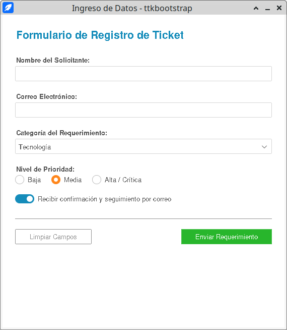


#### Puntos Destacados de esta Implementación

1. **Gestor de Mensajes Integrado (`Messagebox`):**
   Se utiliza `from ttkbootstrap.dialogs import Messagebox`. A diferencia de `tkinter.messagebox` (que genera cuadros de diálogo grises clásicos del sistema), `Messagebox.show_warning()` y `Messagebox.show_info()` despliegan ventanas flotantes estilizadas que respetan los colores del tema activo (`superhero`).

2. **Interruptores tipo Switch (`round-toggle`):**
   Al agregar `bootstyle="round-toggle"` a un `ttk.Checkbutton`, la casilla tradicional de verificación se transforma automáticamente en una palanca deslizante tipo *iOS/Android*.

3. **Uso de Estilos Outline:**
   Para acciones secundarias (como *"Limpiar Campos"*), el uso de `bootstyle="outline-secondary"` dibuja un botón transparente con borde fino que se rellena al pasar el cursor (*hover*), jerarquizando visualmente el botón principal de envío (`bootstyle="success"`).


***
## **Cambiar tema**

Cambiar de tema en tiempo de ejecución (*runtime*) depende de la biblioteca gráfica que estés utilizando. Tanto en **CustomTkinter** como en **`ttkbootstrap`**, este proceso es directo y no requiere reiniciar la aplicación ni reconstruir las ventanas.

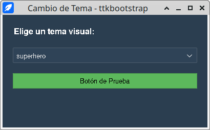

#### En CustomTkinter

CustomTkinter permite alternar instantáneamente entre el **Modo Oscuro** (`"Dark"`), **Modo Claro** (`"Light"`) o sincronizarse con el sistema operativo (`"System"`) mediante la función **`ctk.set_appearance_mode()`**.

<details>
<summary>🖥️ **Código ejemplo con selector desplegable (`CTkOptionMenu`):**</summary>

```python
import customtkinter as ctk

app = ctk.CTk()
app.title("Cambio de Tema - CustomTkinter")
app.geometry("350x200")

# Función callback para cambiar el tema al seleccionar una opción
def cambiar_apariencia(nuevo_modo):
    ctk.set_appearance_mode(nuevo_modo)

label = ctk.CTkLabel(app, text="Selecciona la apariencia:", font=("Roboto", 14))
label.pack(pady=(30, 10))

# Menú desplegable conectado directamente a la función
combo_tema = ctk.CTkOptionMenu(
    app, 
    values=["Dark", "Light", "System"], 
    command=cambiar_apariencia
)
combo_tema.pack(pady=10)

app.mainloop()
```
</details>


#### En `ttkbootstrap`

En `ttkbootstrap`, el estilo visual de toda la aplicación se actualiza en tiempo real invocando el método **`style.theme_use(nombre_tema)`**. Puedes alternar entre temas claros (`flatly`, `minty`, `cosmo`) y oscuros (`darkly`, `cyborg`, `superhero`, `solar`).

<details>
<summary>🖥️ **Código de ejemplo**</summary>

```python
import ttkbootstrap as ttk
from ttkbootstrap.constants import *

# Ventana con tema inicial "superhero"
app = ttk.Window(themename="superhero")
app.title("Cambio de Tema - ttkbootstrap")
app.geometry("400x220")

# Función callback invocada al cambiar la selección
def cambiar_tema(event):
    nuevo_tema = combo_temas.get()
    app.style.theme_use(nuevo_tema)

container = ttk.Frame(app, padding=20)
container.pack(fill=BOTH, expand=YES)

ttk.Label(container, text="Elige un tema visual:", font=("Helvetica", 12, "bold")).pack(anchor=W, pady=(0, 10))

# Lista con temas claros y oscuros
temas_disponibles = ["superhero", "darkly", "cyborg", "flatly", "minty", "cosmo", "solar"]

combo_temas = ttk.Combobox(container, values=temas_disponibles, state="readonly")
combo_temas.set("superhero")
combo_temas.bind("<<ComboboxSelected>>", cambiar_tema)
combo_temas.pack(fill=X, pady=10)

# Botón de muestra para ver la reacción del tema
ttk.Button(container, text="Botón de Prueba", bootstyle="success").pack(fill=X, pady=10)

app.mainloop()
```
</details>


#### 3. En Tkinter / `ttk` Nativo

Si usas `ttk` estándar sin librerías externas, puedes cambiar entre los temas nativos del sistema operativo mediante **`ttk.Style().theme_use()`**:

<details>
<summary>🖥️ Código tkinter</summary>

```python
import tkinter as tk
from tkinter import ttk

root = tk.Tk()
style = ttk.Style()

# Consultar temas disponibles en tu S.O. (p. ej. 'clam', 'alt', 'default', 'vista')
temas = style.theme_names()

def cambiar_tema_nativo(nuevo_tema):
    style.theme_use(nuevo_tema)
```
</details>

